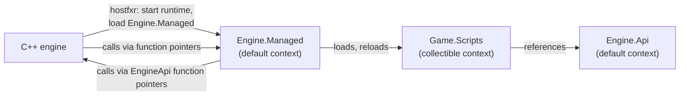

# Hosting from C++

A C++ engine can run C# for gameplay scripts by hosting the .NET runtime in its own process. The engine starts the runtime, loads a managed "engine core" assembly, and exchanges function pointers with it. Game scripts live in a collectible load context, so they can be rebuilt and reloaded without restarting the engine.



## The assemblies

| Assembly | Context | Holds |
| --- | --- | --- |
| `Engine.Api.dll` | Default | The types scripts use: `Entity`, `Vector3`, `ScriptComponent`, `Input`. The scripting API. |
| `Engine.Managed.dll` | Default | The bridge: entry points the engine calls, the script loader, the registry of live script objects. |
| `Game.Scripts.dll` | Collectible custom context | The game's scripts. Rebuilt and reloaded during development. |

`Engine.Api` and `Engine.Managed` are loaded once and never unloaded. Script types derive from `Engine.Api` types, so `Engine.Api` must be in the default context and shared, for the reasons on the [type identity](index.md#type-identity) page.

## Starting the runtime

The `nethost` library (shipped in the .NET SDK's `packs/Microsoft.NETCore.App.Host.<rid>` folder) finds `hostfxr`, which starts the runtime. These are the .NET 8 APIs:

```cpp
#include <nethost.h>
#include <hostfxr.h>
#include <coreclr_delegates.h>

// 1. Find and load hostfxr.
char_t path[1024];
size_t size = sizeof(path) / sizeof(char_t);
get_hostfxr_path(path, &size, nullptr);
void* lib = load_library(path);                                  // LoadLibraryW / dlopen
auto init = (hostfxr_initialize_for_runtime_config_fn)get_export(lib, "hostfxr_initialize_for_runtime_config");
auto get_delegate = (hostfxr_get_runtime_delegate_fn)get_export(lib, "hostfxr_get_runtime_delegate");
auto close = (hostfxr_close_fn)get_export(lib, "hostfxr_close");

// 2. Start the runtime from a runtimeconfig.json naming the framework version.
hostfxr_handle ctx = nullptr;
init(STR("Engine.Managed.runtimeconfig.json"), nullptr, &ctx);

// 3. Get the helpers to load an assembly and to find methods in it.
load_assembly_fn load_assembly = nullptr;
get_function_pointer_fn get_function = nullptr;
get_delegate(ctx, hdt_load_assembly, (void**)&load_assembly);
get_delegate(ctx, hdt_get_function_pointer, (void**)&get_function);
close(ctx);                       // the runtime keeps running; the handle is no longer needed

// 4. Load the bridge into the default context, and find its entry point.
load_assembly(STR("C:/Game/Engine.Managed.dll"), nullptr, nullptr);   // must be an absolute path
using InitFn = int (CORECLR_DELEGATE_CALLTYPE*)(const EngineApi* api, ManagedApi* out);
InitFn managed_init = nullptr;
get_function(STR("Engine.Managed.Bridge, Engine.Managed"), STR("Init"),
             UNMANAGEDCALLERSONLY_METHOD, nullptr, nullptr, (void**)&managed_init);
```

- Check every return code: zero or positive is success. A missing runtime or a wrong framework version fails at step 2, and the error is clearer there than later.
- `char_t` is `wchar_t` on Windows and `char` elsewhere; `STR` is the usual macro for writing literals in it.
- `Engine.Managed.runtimeconfig.json` is written by building `Engine.Managed`. It names the shared framework (`Microsoft.NETCore.App` 8.0), so the runtime installed on the machine is used. For a self-contained game, ship the runtime next to the engine and point `get_hostfxr_path` at it with `get_hostfxr_parameters`.
- Use `hdt_load_assembly` with a null context, as above. The older `hdt_load_assembly_and_get_function_pointer` always loads into an **isolated** context, so `Engine.Api` types loaded there would not match the ones scripts see later.

## Calling across the boundary

Pass function pointers both ways at start-up, as structs of plain C types:

```cpp
// Shared layout, declared in C++ and mirrored in C#.
struct EngineApi {
    void  (*log)(const char* message);
    float (*get_delta_time)();
    void  (*get_position)(uint64_t entity, float* out_xyz);
    void  (*set_position)(uint64_t entity, const float* xyz);
};

struct ManagedApi {
    void (*update)(float dt);
    void (*create_script)(uint64_t entity, const char* type_name);
    void (*destroy_script)(uint64_t entity);
    int  (*reload_scripts)(const char* path);
};
```

```csharp
// Engine.Managed
[StructLayout(LayoutKind.Sequential)]
public unsafe struct EngineApi
{
    public delegate* unmanaged<byte*, void> Log;
    public delegate* unmanaged<float> GetDeltaTime;
    public delegate* unmanaged<ulong, float*, void> GetPosition;
    public delegate* unmanaged<ulong, float*, void> SetPosition;
}

[StructLayout(LayoutKind.Sequential)]
public unsafe struct ManagedApi
{
    public delegate* unmanaged<float, void> Update;
    public delegate* unmanaged<ulong, byte*, void> CreateScript;
    public delegate* unmanaged<ulong, void> DestroyScript;
    public delegate* unmanaged<byte*, int> ReloadScripts;
}

public static unsafe class Bridge
{
    internal static EngineApi Engine;

    [UnmanagedCallersOnly]
    public static int Init(EngineApi* api, ManagedApi* managed)
    {
        Engine = *api;
        managed->Update = &Update;
        managed->CreateScript = &CreateScript;
        managed->DestroyScript = &DestroyScript;
        managed->ReloadScripts = &ReloadScripts;
        return 0;
    }

    [UnmanagedCallersOnly]
    static void Update(float dt) { /* call Update on every live script */ }

    // CreateScript, DestroyScript, ReloadScripts likewise
}
```

- `[UnmanagedCallersOnly]` methods can be called directly from C++ through a function pointer, with no delegate and no marshalling. They must be `static`, and take and return only blittable types: numbers, pointers, and structs of those.
- `delegate* unmanaged<...>` (C# 9 function pointers) call C++ the same way, without `Marshal.GetDelegateForFunctionPointer`.
- Pass strings as UTF-8 `byte*` and convert with `Marshal.PtrToStringUTF8` or `Encoding.UTF8`. Pass vectors as pointers to floats, or as blittable structs with the same layout on both sides.
- **An exception must never cross into C++.** The runtime terminates the process if one escapes an `[UnmanagedCallersOnly]` method. Wrap each entry point in `try`/`catch`, log the exception, and return an error code.
- The `Engine.Api` types scripts see wrap these calls: `entity.Position` calls `Bridge.Engine.GetPosition`. Scripts never see pointers.

## Script objects and the engine

The engine stores entities; scripts are C# objects. The engine identifies a script by its entity id, and `Engine.Managed` keeps the mapping:

```csharp
static readonly Dictionary<ulong, ScriptComponent> Scripts = new();
```

Keep the table on the managed side and pass ids across the boundary, not object references. If C++ must hold a reference to a managed object, use `GCHandle.Alloc(obj)` and pass `GCHandle.ToIntPtr(handle)`. The object then stays alive until the handle is freed with `handle.Free()`. Every handle to a script object is a reference that will block unloading.

## Reloading scripts

```csharp
sealed class ScriptLoadContext : AssemblyLoadContext
{
    public ScriptLoadContext() : base("Scripts", isCollectible: true) { }

    protected override Assembly? Load(AssemblyName name) => null;   // everything else from the default context
}

static ScriptLoadContext? _context;
static Assembly? _scripts;

static void LoadScripts(string dllPath)
{
    _context = new ScriptLoadContext();
    using var dll = new MemoryStream(File.ReadAllBytes(dllPath));
    using var pdb = new MemoryStream(File.ReadAllBytes(Path.ChangeExtension(dllPath, ".pdb")));
    _scripts = _context.LoadFromStream(dll, pdb);
}

[MethodImpl(MethodImplOptions.NoInlining)]
static WeakReference UnloadScripts()
{
    var weak = new WeakReference(_context);
    _context!.Unload();
    _context = null;
    _scripts = null;
    return weak;
}
```

A reload goes through these steps:

1. **Save state.** For each live script, write its serialised fields (to JSON, or your own format) keyed by entity id and type name.
2. **Drop every reference into the old assembly:** clear `Scripts`, free `GCHandle`s, remove event subscriptions scripts made on engine events, and clear caches of script `Type`s and reflection data.
3. **Unload** and wait for the context to be collected, as in [unloading plugins](plugins.md#unloading). If it is still alive after a few collections, report it and keep running with the new context anyway: a leaked context only costs memory until restart.
4. **Load** the new `Game.Scripts.dll` into a new context, from a stream so the build can overwrite the file next time.
5. **Recreate** each script by type name, and restore the saved fields that still exist and have the same type. Fields that were added keep their defaults; fields that were removed are dropped.
6. Call each script's start method again, or a dedicated `OnReloaded`, so it can rebuild cached references to other scripts.

The serialisation is the same problem as a [save system](../../unity/systems/saving/save-system.md), and the same rules apply: save data, not references, and match by stable names.

Things that commonly keep the old context alive: `static` fields in `Engine.Api` holding script objects (a singleton registry), `Engine.Api` events with script handlers, `Task`s or threads started by scripts that are still running, and serializers that cache per-type data. Give `Engine.Api` a reset hook, called in step 2, that clears everything it holds that could refer to script types.
