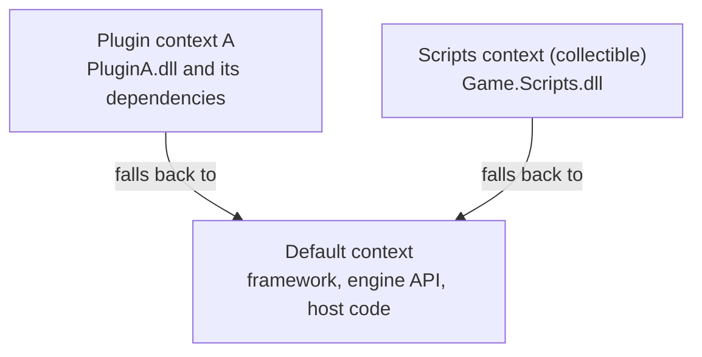

# Assemblies and load contexts

An **assembly** is the unit .NET compiles to and loads: a `.dll` holding IL code, metadata describing every type and member, and a manifest naming the assembly and the assemblies it references. A **load context** (`AssemblyLoadContext`, .NET Core 3.0 and later) decides which file is loaded when an assembly is asked for, and lets a group of assemblies be unloaded together. Together they are how an engine loads game scripts and plugins, and reloads them while running.

This page covers the model. [Plugins](plugins.md) builds a plugin loader in a .NET application or editor, and [hosting from C++](hosting.md) runs .NET inside a native engine, with scripts that reload.

## Assembly identity

An assembly's name has four parts: a simple name (`Game.Scripts`), a version, a culture, and an optional public key token (for strong-named assemblies). A reference in one assembly to another records that name. The runtime resolves it to a file **at run time**, when code that uses the assembly first runs, not when the program starts.

```csharp
AssemblyName name = typeof(Player).Assembly.GetName();
// Game.Scripts, Version=1.0.0.0, Culture=neutral, PublicKeyToken=null
```

.NET Core does not enforce versions the way .NET Framework did: the default context loads whatever version of an assembly the application shipped with, as long as it is at least the version referenced.

## Load contexts



- The **default context** holds the framework and the application. Its assemblies are found from the application's dependency list (the `.deps.json` file, turned into the "trusted platform assemblies" list at start-up).
- A **custom context** is a class derived from `AssemblyLoadContext`. Its `Load` method decides where each requested assembly comes from. Returning `null` from `Load` falls back to the default context.
- Each context can hold its own copy of an assembly. Two plugins can use different versions of the same library without conflict, because each context loads its own.
- A context created with `isCollectible: true` can be **unloaded**, with every assembly in it. This is the only way to unload code in .NET Core: there are no app domains.

Each assembly is loaded at most once per context. `AssemblyLoadContext.GetLoadContext(assembly)` tells you which context an assembly belongs to.

## Resolution order

When code in context C first uses a type from assembly X:

1. If X is already loaded in C, use it.
2. Call `C.Load(name)`. If it returns an assembly, use it.
3. Otherwise, try the default context: its loaded assemblies, then its dependency list.
4. If still not found, raise C's `Resolving` event, then `AppDomain.CurrentDomain.AssemblyResolve`.
5. If nothing returns an assembly, throw `FileNotFoundException`.

The default context only runs steps 1, 3, 4, and 5, because its `Load` is not overridable. Plugins in custom contexts get to choose at step 2.

## Type identity

A type is identified by its name **and the assembly instance it was loaded from**. If `Contracts.dll` is loaded into two contexts, there are two different `IPlugin` types with the same name, and a cast from one to the other fails:

```text
System.InvalidCastException: Unable to cast object of type 'PluginA.Weapon'
to type 'Contracts.IWeapon'.
```

The message names the right types, which makes it confusing. The cause is that the plugin's `IWeapon` came from a second copy of `Contracts.dll`, loaded in the plugin's context, while the host's came from the default context.

The rule that follows: **assemblies that define types shared between the host and plugins must be loaded once, in the default context.** A plugin context's `Load` returns `null` for them, so they fall back to the default. See [shared contracts](plugins.md#shared-contracts).

## Unloading

```csharp
var context = new ScriptLoadContext(path, isCollectible: true);
// ... load assemblies, run code ...
context.Unload();
```

`Unload` only **starts** unloading. The assemblies are freed after the garbage collector finds no remaining references to anything from the context: its types, its objects, its delegates, its `Assembly` objects, or the context itself. One forgotten reference keeps the whole context alive, with no error. Checking for that is covered in [unloading plugins](plugins.md#unloading).

## Unity

Unity runs on Mono (and IL2CPP in players), not on .NET Core, and does not use `AssemblyLoadContext`. It splits code into assemblies with assembly definition files (`.asmdef`), and reloads code by **domain reload**: discarding the whole scripting domain and loading every assembly again after a script changes, or when entering Play Mode unless that is turned off in Enter Play Mode settings. This page and the next two apply to .NET 8 applications, editors, and engines that host .NET themselves.
