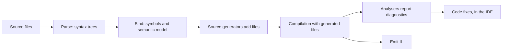

# Roslyn analysers and source generators

Roslyn is the C# compiler, and it loads plug-ins. An **analyser** inspects code and reports diagnostics: the warnings and errors in the IDE and the build output. A **source generator** adds new source files to the compilation while it is being built. Both are ordinary C# classes in a class library that the compiler loads.

## Where they run



- Generators run once per compilation, before analysers. They can only **add** files. They cannot change or remove existing code, and they cannot see each other's output.
- Analysers see the finished compilation, generated files included, and report diagnostics. They cannot change code.
- Code fixes are IDE features: a light bulb offered for a diagnostic, which edits the document when chosen. The compiler never runs them.
- The IDE runs the same plug-ins continuously as you type, so a slow generator or analyser makes typing slow. That is why the [incremental](source-generators.md) API exists.

## Three views of code

| | What it is | Good for |
| --- | --- | --- |
| Syntax | The parse tree: `ClassDeclarationSyntax`, `InvocationExpressionSyntax`, tokens and trivia. Exactly what was typed. | Fast filtering ("is this a class with attributes?"), and finding where to report or edit. |
| Symbols | The meaning: `INamedTypeSymbol`, `IMethodSymbol`, `IFieldSymbol`. Types resolved, base classes known, partial declarations merged. | Almost every real check ("does this type derive from `MonoBehaviour`?"). |
| Operations | A language-neutral tree of what executes: `IInvocationOperation`, `IAssignmentOperation`. | Analysing method bodies without matching every syntax form. |

Filter on syntax first, because it is cheap, then confirm with symbols. Compare symbols with `SymbolEqualityComparer.Default`, never with `==` or by name.

## Project setup

Analysers and generators must target **.NET Standard 2.0**, whatever the consuming project targets, because the compiler loads them into its own process.

```xml
<Project Sdk="Microsoft.NET.Sdk">
  <PropertyGroup>
    <TargetFramework>netstandard2.0</TargetFramework>
    <LangVersion>latest</LangVersion>
    <Nullable>enable</Nullable>
    <IsRoslynComponent>true</IsRoslynComponent>
    <EnforceExtendedAnalyzerRules>true</EnforceExtendedAnalyzerRules>
  </PropertyGroup>
  <ItemGroup>
    <PackageReference Include="Microsoft.CodeAnalysis.CSharp" Version="4.3.0" PrivateAssets="all" />
    <PackageReference Include="Microsoft.CodeAnalysis.Analyzers" Version="3.3.4" PrivateAssets="all" />
  </ItemGroup>
</Project>
```

- `LangVersion latest` applies to the plug-in's own code, so it can use records and raw string literals. The **generated** code must compile in the consuming project's language version.
- `EnforceExtendedAnalyzerRules` turns on rules that catch what breaks plug-ins: file and network access (RS1035), and missing `[Generator]` or `[DiagnosticAnalyzer]` attributes. Plug-ins must read input only through the compiler, or the IDE's caching goes wrong.
- `Microsoft.CodeAnalysis.Analyzers` adds rules for writing analysers, including RS2008, which asks you to track rule ids in `AnalyzerReleases.Shipped.md` and `AnalyzerReleases.Unshipped.md`. Add the two files, or turn the rule off for a private project.
- The compiler version that loads the plug-in must be at least the `Microsoft.CodeAnalysis.CSharp` version it references. Reference the lowest version that has the APIs you need: 4.3 has everything on these pages.
- Avoid NuGet dependencies in the plug-in. Each one has to be shipped and loaded next to it as another analyser assembly.

Records and `init` need a small polyfill on .NET Standard 2.0:

```csharp
namespace System.Runtime.CompilerServices
{
    internal static class IsExternalInit { }
}
```

A project in the same solution consumes the plug-in through a project reference marked as an analyser:

```xml
<ItemGroup>
  <ProjectReference Include="..\GameTools.Generators\GameTools.Generators.csproj"
                    OutputItemType="Analyzer" ReferenceOutputAssembly="false" />
</ItemGroup>
```

To see generated files on disk, add `<EmitCompilerGeneratedFiles>true</EmitCompilerGeneratedFiles>` to the consuming project; they appear under `obj/`. Visual Studio and Rider also list them in the project tree, under Dependencies → Analyzers.

## Unity setup

Unity 6 compiles your scripts with its own copy of the compiler and loads plug-ins from DLLs in the project:

1. Build the plug-in project in Release, against **Microsoft.CodeAnalysis.CSharp 4.3**, which is the version Unity documents for its compiler.
2. Copy the DLL anywhere under `Assets`.
3. Select it, and in the Plugin Inspector untick **Any Platform**, then untick **Editor**, **Standalone**, and every other platform. It must not load as a runtime plug-in.
4. Give it the asset label **`RoslynAnalyzer`**. The label is case-sensitive. Unity recompiles and runs the plug-in.

Where the DLL sits decides which code it applies to:

- In a folder with no assembly definition above it: all the predefined assemblies (`Assembly-CSharp` and friends), but not code in your own `.asmdef` assemblies.
- In a folder with an `.asmdef`, or below one: that assembly, and every assembly that references it. A package can ship an analyser that only checks code using the package.

Other differences from a .NET project:

- **Language version.** Unity 6 compiles C# 9. Generated code must not use file-scoped namespaces, raw string literals, `required`, or other later features, even though the generator itself can.
- **Duplicate types.** A generator that adds the same public type to several assemblies, where one references another, causes CS0436 warnings. Make generated helper types `internal`, as the [source generator](source-generators.md#the-attribute) page does.
- **Additional files** must use the `.additionalfile` extension and be named `Name.AnalyzerName.additionalfile`, where `Name` has no dots and `AnalyzerName` matches the analyser's name exactly. Each assembly receives only the files named for analysers that run on it. See [additional files](generator-examples.md#generating-from-a-data-file).
- **Severity** is set with `.ruleset` files: `Default.ruleset` in the root of `Assets` applies to every assembly, `Assembly-CSharp.ruleset` (and the other predefined names) to one predefined assembly, and a `.ruleset` next to an `.asmdef` to that assembly.
- **Code fixes** come from the IDE, which reads the analysers listed in the `.csproj` files that Unity generates. Unity itself never runs them.

Microsoft's [Microsoft.Unity.Analyzers](https://github.com/microsoft/Microsoft.Unity.Analyzers) already covers many Unity rules, such as `?.` and `??` on Unity objects. It comes with Visual Studio Tools for Unity and the Visual Studio Code Unity extension. Check it before writing your own.

## Pages

- [Source generators](source-generators.md) — the incremental pipeline, value-equal models, and a generator that writes change-notifying properties.
- [Generator examples](generator-examples.md) — fast enum `ToString`, a type registry built from attributes, and constants generated from a CSV file.
- [Analysers](analyzers.md) — diagnostics, rules for the generator's attributes, a Unity performance rule, whole-compilation checks, and suppressors.
- [Code fixes](code-fixes.md) — light-bulb fixes that edit the document, and fixing every occurrence at once.
- [Testing](testing.md) — testing analysers, fixes, and generators, including checking that a generator's caching works.
