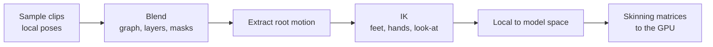

# Animation runtime

How an engine turns animation clips into a deformed character each frame. Every animated character runs the same pipeline:

- [Clips, sampling, and compression](clips.md) — skeletons, poses in local space, keyframe tracks, sampling, and making clips small.
- [Blending and graphs](blending.md) — blending poses, additive layers, bone masks, blend spaces, synchronising cycles, state machines, and inertialization.
- [Skinning](skinning.md) — bind poses, skinning matrices, linear blend and dual quaternion skinning, GPU skinning, and running the pipeline as jobs.
- [Root motion and IK](root-motion-ik.md) — extracting the root's movement for the character controller, two-bone IK, and planting feet on uneven ground.

The [Unity animation](../../unity/animation/index.md) pages cover the same ideas through Unity's Animator.
