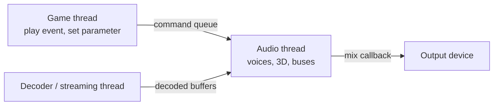

# Audio engine

How an engine plays sound: a real-time mixer on its own thread, voices placed in 3D around a listener, compressed audio decoded and streamed within a memory budget, and an event-based API that lets sound designers change how things sound without touching game code.

- [Mixer and voices](mixer.md) — the audio callback, the rules for the audio thread, voices with priorities and virtual voices, buses, effects, and ducking.
- [3D audio](spatial.md) — attenuation, panning and HRTF, Doppler, occlusion, reverb, and where the listener is.
- [Streaming and formats](streaming.md) — PCM, ADPCM, Vorbis, and Opus, what to keep in memory and what to stream, and loops.
- [Game-side API](api.md) — sound events and parameters, playing instances, snapshots, and limiting how many of one sound play.

Middleware (FMOD, Wwise) provides all of this, with authoring tools for designers. These pages describe what such an engine does inside, whether you use one or write your own.
