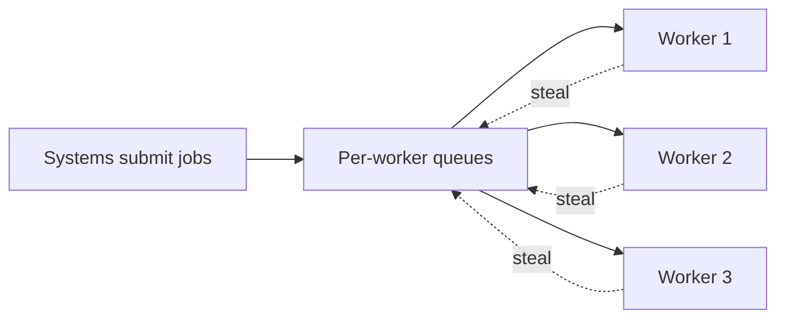

# Job system

A job system spreads the frame's work across every CPU core. Instead of giving each subsystem its own thread (a physics thread, an AI thread), it splits work into small **jobs** and runs them on a pool of worker threads, one per core. Any core can run any job, so the load balances itself.

Why not a thread per system: the threads are only busy while their system has work, a frame is as slow as the busiest one, and adding cores does nothing once there are more cores than systems. A job pool keeps every core busy as long as there are jobs, and scales with the core count.

## Pages

- [Scheduler](scheduler.md) — workers, per-worker queues with work stealing, sleeping and waking, counters, and waiting by helping.
- [Dependencies and job graphs](dependencies.md) — job handles that start other jobs when they finish, and a per-frame graph built from what each system reads and writes.
- [Parallel for and data layout](parallel-for.md) — splitting loops into batches, choosing batch sizes, per-thread output, false sharing, and keeping results deterministic.
- [Fibers](fibers.md) — jobs that can pause mid-function to wait, by switching stacks, and the problems that brings.

The pseudocode uses C++-style atomics where the memory ordering matters. The [frame](../patterns/frame.md) page covers what runs in the frame and what may stall.
