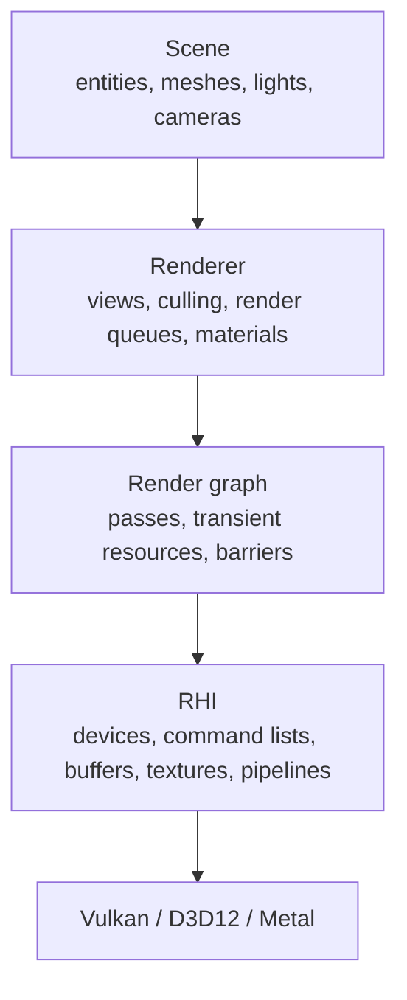

# Render architecture

How an engine's renderer is layered, from the graphics API up to the scene. Each layer only talks to the one below it:

- [RHI design](rhi.md) — a thin abstraction over the graphics APIs: devices, queues, command lists, resources and views, pipelines, and binding with descriptors or bindless.
- [Frames in flight](frames-in-flight.md) — letting the CPU work ahead of the GPU safely: fences, per-frame resources, upload rings, deferred deletion, and presenting.
- [Render graph](render-graph.md) — declaring a frame's passes and resources, then letting the graph order them, insert barriers, alias memory, and skip unused work.
- [Renderer layer](renderer.md) — turning the scene into draw calls: views, visibility, render queues and sort keys, materials, and pipeline caching.
- [Viewports and windows](viewports.md) — several swapchains, editor viewports rendered to textures, and resizing.

The pseudocode uses names close to Vulkan and D3D12. The [frame](../patterns/frame.md) page covers handing data from the simulation to a render thread.
