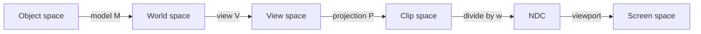

# Coordinate spaces

The same point, written in a different frame at each stage of the pipeline. A vertex starts in object space and is transformed until the rasteriser can place it in a pixel. Getting the *order* of those transforms wrong is a more common bug than getting any one matrix wrong.

Points on this page are column vectors. A matrix applies on the left.

!!! warning "Column vectors multiply on the left"

    Model, then view, then projection, is the product

    \[
    \mathbf{p}_{\text{clip}} = P\, V\, M\, \mathbf{p}_{\text{object}}
    \]

    Read it right to left. The other convention stores the point as a row on the left and multiplies \(\mathbf{p}\, M\, V\, P\). Those matrices are the transposes of these ones. Mixing the two conventions does not throw; it reverses the pipeline.

## Object space

Coordinates relative to the mesh. The authoring tool decides where the origin is and which axis is up. A vertex does not know which instance it belongs to, so object space is where the mesh data stays.

## World space

\[
\mathbf{p}_{\text{world}} = M\, \mathbf{p}_{\text{object}}
\qquad
M = T\, R\, S
\]

\(S\) scales in the mesh’s own axes, \(R\) rotates, and \(T\) translates. That order is what “a 2× scale on the model’s X axis” means. Scaling after the rotation scales in world axes and, if the scale is non-uniform, is a different transform. \(R\) is a pure rotation: its upper 3×3 is orthonormal and its determinant is \(+1\). A mirror belongs in \(S\) as a negative scale. Folded into \(R\), the matrix no longer has determinant \(+1\), and an inverse written as a transpose is then wrong.

\[
T = \begin{bmatrix} I & \mathbf{t} \\ \mathbf{0}^{\mathsf T} & 1 \end{bmatrix}
\qquad
S = \operatorname{diag}(s_x, s_y, s_z, 1)
\]

## View space

The view matrix is the inverse of the camera’s camera-to-world matrix. If the camera sits at \(\mathbf{c}\) and the columns of \(R\) are its local axes written in world space,

\[
C = \begin{bmatrix} R & \mathbf{c} \\ \mathbf{0}^{\mathsf T} & 1 \end{bmatrix}
\qquad
V = C^{-1} = \begin{bmatrix} R^{\mathsf T} & -R^{\mathsf T}\mathbf{c} \\ \mathbf{0}^{\mathsf T} & 1 \end{bmatrix}
\]

The inverse formula needs \(R\) to be a rotation. It does not, by itself, decide which local axis is “forward”. That is a convention, and the projection matrix has to use the same one:

| Convention | Handedness | Camera looks along | Typical NDC \(z\) after the divide |
| --- | --- | --- | --- |
| OpenGL view space | Right-handed, \(+Y\) up | \(-Z\) | \([-1, 1]\), near at \(-1\) |
| Direct3D view space | Left-handed, \(+Y\) up | \(+Z\) | \([0, 1]\), near at \(0\) |
| Unity, world and transforms | Left-handed, \(+X\) right, \(+Y\) up, \(+Z\) forward | The camera transform’s \(+Z\) | — |
| Unity, camera space | OpenGL’s right-handed view space | \(-Z\) | Depends on the graphics API |

Unity is the awkward row. `Camera.worldToCameraMatrix` is the view matrix the rest of this page means, and the manual states that it follows the OpenGL convention: forward is negative Z. `transform.worldToLocalMatrix` does not. They differ by a flip of the Z axis, which is why a hand-rolled view matrix built only from the camera transform will not match `worldToCameraMatrix` until that flip is applied. In a shader, a point in front of a Unity camera has negative view-space \(z\).

## Clip space

\[
\mathbf{p}_{\text{clip}} = P\, \mathbf{p}_{\text{view}}
\]

The fourth component is part of the result. For a perspective projection it carries the view-space depth, and the later divide by it is what makes things further away smaller. Dropping \(w\) before that divide is the usual reason a “perspective” projection still looks orthographic.

\(\theta\) is the vertical field of view in radians, \(a\) is width divided by height, and \(n\) and \(f\) are the positive distances to the near and far planes.

OpenGL, right-handed, looking down \(-Z\), with clip \(z\) in \([-w, w]\):

\[
P_{\text{GL}} =
\begin{bmatrix}
\dfrac{1}{a\tan(\theta/2)} & 0 & 0 & 0 \\[1em]
0 & \dfrac{1}{\tan(\theta/2)} & 0 & 0 \\[1em]
0 & 0 & -\dfrac{f+n}{f-n} & -\dfrac{2fn}{f-n} \\[1em]
0 & 0 & -1 & 0
\end{bmatrix}
\]

A visible point has negative view-space \(z\), so \(\textit{clip}_w = -z_{\text{view}}\) is positive. The near plane lands on NDC \(z = -1\) and the far plane on \(+1\).

Direct3D, left-handed, looking down \(+Z\), with NDC \(z\) in \([0, 1]\):

\[
P_{\text{D3D}} =
\begin{bmatrix}
\dfrac{1}{a\tan(\theta/2)} & 0 & 0 & 0 \\[1em]
0 & \dfrac{1}{\tan(\theta/2)} & 0 & 0 \\[1em]
0 & 0 & \dfrac{f}{f-n} & -\dfrac{fn}{f-n} \\[1em]
0 & 0 & 1 & 0
\end{bmatrix}
\]

Here \(\textit{clip}_w = z_{\text{view}}\). The near plane lands on NDC \(z = 0\) and the far plane on \(1\).

## NDC

Normalised device coordinates are the perspective divide:

\[
\mathbf{p}_{\text{ndc}}
  = \left(
      \frac{x_{\text{clip}}}{w_{\text{clip}}},\;
      \frac{y_{\text{clip}}}{w_{\text{clip}}},\;
      \frac{z_{\text{clip}}}{w_{\text{clip}}}
    \right)
\]

\(x\) and \(y\) lie in \([-1, 1]\) for a point inside the frustum. \(+Y\) is up. \(z\) is the depth value described above, still not a pixel.

Modern engines often reverse the depth range, mapping the near plane to the end of the range that has more float precision (NDC \(z = 1\) on a \([0, 1]\) target, with the far plane at \(0\)). For the Direct3D-style \(w = z\) projection, the third row that does this is

\[
\textit{clip}_z = A\, z_{\text{view}} + B
\qquad
A = -\frac{n}{f - n}
\qquad
B = \frac{fn}{f - n}
\]

Unity defines `UNITY_REVERSED_Z` on the APIs that draw this way (Direct3D, Vulkan, Metal). OpenGL targets generally do not, and keep the \([-1, 1]\) range. A shader that hard-codes “0 is the near plane” is wrong on one of those two.

The divide is also why interpolation of a vertex attribute across a triangle has to be perspective-correct. Interpolate \(a / w\) and \(1 / w\) in screen space, then divide. A straight lerp of \(a\) slides in screen space and looks wrong as soon as the triangle is large and close.

## Screen space

The viewport maps NDC \(x\) and \(y\) into pixel coordinates. \(w\) and \(h\) are the viewport size in pixels and \((x_0, y_0)\) is its origin.

Most game and UI framebuffers put the origin at the top left and treat \(+Y\) as down, which flips the NDC \(Y\) axis:

\[
x_{\text{screen}} = x_0 + \frac{x_{\text{ndc}} + 1}{2}\, w
\qquad
y_{\text{screen}} = y_0 + \frac{1 - y_{\text{ndc}}}{2}\, h
\]

The OpenGL window coordinate system puts the origin at the bottom left, so the \(Y\) formula loses the flip and uses \(y_{\text{ndc}} + 1\) instead. Depth is written from NDC \(z\) through a separate viewport scale and bias into the range the depth buffer expects; it does not go through the formulas above.
