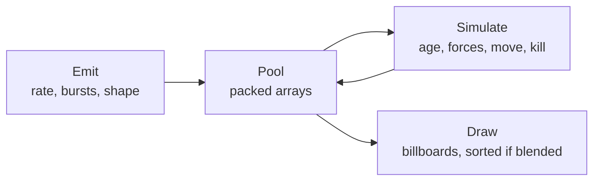

---
uses:
  - name: Shooters
    text: Muzzle flashes, sparks, and smoke from a pool that never allocates.
  - name: Hordes and crowds
    text: Thousands of particles simulated on the GPU for swarms, ash, and blood mist.
  - name: Open worlds
    text: Weather around the camera, with only a screen's worth of particles alive.
---

# Particle systems

Many small, short-lived, mostly independent things: sparks, smoke, rain, dust. A particle system keeps them in a fixed pool, emits new ones from an emitter, moves them every frame, and draws each as a small quad facing the camera. This page builds one in Python-style pseudocode, then covers blending and sorting, and CPU against GPU simulation. The [Unity page](../unity/rendering/particles.md) covers Unity's Particle System and VFX Graph.



The code runs as written. It shows the parts, not a fast implementation: a real one stores floats in flat arrays and is written in a compiled language or a shader.

## Storage

A particle is a few numbers: position, velocity, age, lifetime, size, and a random seed for variety. Store them as a **structure of arrays**, one array per field, sized once. The live particles are packed at the front; killing one moves the last live particle into its slot.

```python
class Particles:
    """Structure of arrays, with the live particles packed at the front."""
    def __init__(self, capacity):
        self.capacity = capacity
        self.count = 0
        self.pos = [(0.0, 0.0, 0.0)] * capacity
        self.vel = [(0.0, 0.0, 0.0)] * capacity
        self.age = [0.0] * capacity
        self.life = [1.0] * capacity
        self.size = [1.0] * capacity
        self.seed = [0.0] * capacity      # a random number per particle, for variety in curves

    def spawn(self, pos, vel, life, size):
        if self.count == self.capacity:
            return False                   # full: drop it (or overwrite the oldest)
        i = self.count
        self.pos[i], self.vel[i], self.age[i], self.life[i], self.size[i] = pos, vel, 0.0, life, size
        self.seed[i] = random.random()
        self.count += 1
        return True

    def kill(self, i):
        # Swap the last live particle into the hole. O(1), and the live ones stay packed.
        last = self.count - 1
        for array in (self.pos, self.vel, self.age, self.life, self.size, self.seed):
            array[i] = array[last]
        self.count -= 1
```

- **No allocation** after start-up. The pool is the [free list](../data-structures/free-list.md) idea without the list: packing means "live" is simply `index < count`.
- **Order is not kept.** Swap-remove scrambles the order, which does not matter unless particles are drawn sorted, and sorting happens at draw time anyway.
- **Full pool.** Drop new particles, as here, or overwrite the oldest, which is a [ring buffer](../data-structures/ring-buffer.md): right for blood on the ground or bullet holes, where the newest matter most.
- **Arrays of fields** keep each pass over one field contiguous in memory, which the simulation loop and the GPU upload both want.

## Emitting

```python
class Emitter:
    def __init__(self, particles, rate, life, speed):
        self.particles, self.rate, self.life, self.speed = particles, rate, life, speed
        self.carry = 0.0                   # fractional particles owed from earlier frames
        self.bursts = []                   # (time, count), sorted
        self.time = 0.0

    def update(self, dt, origin):
        due = self.carry + self.rate * dt
        n = int(due)
        self.carry = due - n               # keep the fraction: 30/s at 144 fps still emits 30/s
        for burst_time, burst_count in self.bursts:
            if self.time < burst_time <= self.time + dt:
                n += burst_count
        self.time += dt
        for _ in range(n):
            direction = random_unit_vector()
            vel = tuple(d * self.speed for d in direction)
            self.particles.spawn(origin, vel, self.life, 0.2)

def random_unit_vector():
    # Uniform on the sphere: uniform height, uniform angle.
    z = random.uniform(-1.0, 1.0)
    a = random.uniform(0.0, 2 * pi)
    r = sqrt(1 - z * z)
    return (r * cos(a), r * sin(a), z)
```

- **Carry the fraction.** 30 particles a second at 144 frames a second is 0.21 a frame. Rounding each frame emits none; carrying the remainder emits 30 a second at any frame rate.
- **Bursts** are counts at set times: a muzzle flash is one burst of 20 and no rate.
- **Shape** is where particles start and which way they go: a point, a sphere, a cone, a mesh surface. A uniform direction needs uniform height and angle, as `random_unit_vector` does; normalising a random cube point clusters toward the corners. The [random distributions](../maths/random.md) page has the shapes.
- **Moving emitters** leave gaps at speed, because one frame's particles all start at the same point. Spread the frame's spawns along the path from last frame's position to this one's, each with its share of the frame's time already aged.

## Simulating

```python
def simulate(p, dt, gravity=(0.0, -9.81, 0.0), drag=0.5):
    i = 0
    while i < p.count:
        p.age[i] += dt
        if p.age[i] >= p.life[i]:
            p.kill(i)                      # the swapped-in particle is at i: do not advance
            continue
        damp = 1.0 / (1.0 + drag * dt)     # stable for any dt, unlike (1 - drag * dt)
        vx, vy, vz = p.vel[i]
        vx, vy, vz = (vx + gravity[0] * dt) * damp, (vy + gravity[1] * dt) * damp, (vz + gravity[2] * dt) * damp
        p.vel[i] = (vx, vy, vz)
        x, y, z = p.pos[i]
        p.pos[i] = (x + vx * dt, y + vy * dt, z + vz * dt)   # semi-implicit Euler: new velocity, then position
        i += 1
```

- **Kill in place.** After a swap-remove, the particle now at `i` has not been updated; do not advance `i`.
- **Integrate** with semi-implicit Euler, new velocity then position, as the [integrators](../physics/integrators.md) page explains. It is stable enough for particles at any normal frame rate.
- **Drag** as `1 / (1 + drag * dt)` never reverses the velocity, however large the step. `1 - drag * dt` goes negative for large `dt`.
- **Most systems need no collision.** For those that do, the cheap options are a ground plane, or the depth buffer on the GPU. Ray casts per particle are expensive.

## Over lifetime

Size, colour, alpha, and speed usually follow a curve from birth to death. Sample it at `t = age / life`:

```python
def over_life(curve, t):
    """Piecewise-linear curve: [(t0, v0), (t1, v1), ...] with t from 0 to 1."""
    if t <= curve[0][0]:
        return curve[0][1]
    for (t0, v0), (t1, v1) in zip(curve, curve[1:]):
        if t <= t1:
            return v0 + (v1 - v0) * (t - t0) / (t1 - t0)
    return curve[-1][1]
```

```python
# A spark: grows quickly, then shrinks away.
size = base_size * over_life([(0.0, 0.0), (0.1, 1.0), (1.0, 0.0)], p.age[i] / p.life[i])
```

Add `seed` to vary each particle: pick between two curves with it, or offset its rotation. Engines bake curves into small lookup textures or arrays, so sampling is one read.

## Drawing

Each particle is a quad that faces the camera, a **billboard**. Its corners are the particle's centre plus the camera's right and up vectors, scaled by its size:

```python
def billboard(center, size, cam_right, cam_up):
    """Four corners of a camera-facing quad, in the order a, b, c, d around it."""
    r = tuple(c * size * 0.5 for c in cam_right)
    u = tuple(c * size * 0.5 for c in cam_up)
    def at(sr, su):
        return tuple(center[k] + r[k] * sr + u[k] * su for k in range(3))
    return at(-1, -1), at(-1, 1), at(1, 1), at(1, -1)
```

| Kind | Corners from | Use for |
| --- | --- | --- |
| **Billboard** | Camera right and up | Smoke, sparks, glows. |
| **Stretched** | Velocity and the camera's view of it | Sparks, rain, tracers: long along their motion. |
| **Horizontal** | World X and Z | Ripples, ground dust, decals on a flat floor. |
| **Mesh** | A small mesh per particle, instanced | Debris, shell casings, leaves. |

Rather than four vertices per particle on the CPU, engines upload one entry per particle and expand it into a quad in the vertex shader, or draw with GPU instancing. **Flipbooks** animate the texture: a grid of frames in one atlas, with the frame chosen from age.

## Blending and sorting

| Blend | Looks like | Sorting |
| --- | --- | --- |
| **Additive** | Light: fire, sparks, magic. Overlaps get brighter. | Not needed: addition is order independent. |
| **Alpha** | Matter: smoke, dust, blood. | Needed: back to front, or particles in front are hidden by ones behind. |
| **Premultiplied alpha** | Both in one texture: a fireball that glows and smokes. | Needed. |

```python
def back_to_front(p, cam_pos, cam_forward):
    """Indices of live particles, farthest first, for alpha blending."""
    def depth(i):
        d = tuple(p.pos[i][k] - cam_pos[k] for k in range(3))
        return d[0] * cam_forward[0] + d[1] * cam_forward[1] + d[2] * cam_forward[2]
    return sorted(range(p.count), key=depth, reverse=True)
```

- **Soft particles.** A flat quad cutting through the floor shows a hard line. Fading alpha by the distance between the particle and the depth buffer behind it hides the line.
- **Sorting between systems.** Two blended systems in each other's space still sort per system, not per particle across both. Engines give systems a sorting order or offset to fix the common cases.
- **Overdraw** is the main cost of particles: big, overlapping, blended quads fill the same pixels many times. Fewer, smaller, and tighter-cropped quads fix it, not fewer simulation steps.

## CPU or GPU

| | CPU | GPU (compute shader) |
| --- | --- | --- |
| **Count** | Thousands | Hundreds of thousands to millions |
| **Gameplay can read particles** | Yes: collisions with physics, events per particle, triggers | Not without slow read-back. Effects only. |
| **Collision** | Physics queries, planes | Depth buffer, signed distance fields |
| **Emission** | Any code | Events from the CPU, or from other GPU particles |
| **Platforms** | Everywhere | Needs compute shader support |

A GPU system keeps the pool in a buffer, simulates in a compute shader, and draws with an indirect draw whose count the shader wrote. The CPU only sends emission events and parameters. Use the CPU for effects that gameplay touches, and the GPU for volume.

## Smaller topics

- **Culling.** An emitter off screen can stop simulating, then catch up or skip ahead when seen. Catching up a long-paused system costs a spike.
- **Prewarm.** Smoke that should already be rising on level load simulates a few seconds at start-up.
- **Level of detail.** Halve the emission rate and double the size at a distance: the same coverage for a quarter of the particles.
- **Fixed steps.** Simulate a system with a fixed step, as the [fixed timestep](../physics/fixed-timestep.md) page describes, when it must behave the same at every frame rate, for example in a replay.

!!! warning "Common pitfalls"

    Allocating each particle as an object. Thousands of allocations a second feed the garbage collector. Use fixed arrays.

    Rounding emission per frame. Low rates emit nothing at high frame rates. Carry the fraction.

    Forgetting to re-check index `i` after a swap-remove skips a particle for a frame.

    Alpha-blended particles drawn unsorted. Smoke behind a puff shows through it.

    Optimising simulation when the cost is overdraw. Measure the GPU first.
