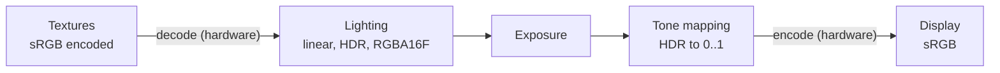

# Colour pipeline

Lighting maths only works on linear light values. Textures are stored, and displays expect, values encoded for human perception. Real scenes span a brightness range far beyond what a display can show. The colour pipeline converts between these at the right points: decode inputs to linear, light in high dynamic range, expose, tone map, and encode for the display.



## Linear and sRGB

The **sRGB** encoding stores colours with roughly a 2.2 power curve, spending more of the 8 bits on dark values where eyes are more sensitive. A pixel value of 0.5 in an sRGB texture is about 21 % of the light of 1.0, not 50 %.

- Lighting maths (adding lights, multiplying by albedo, blending) is only correct on **linear** values. Doing it on sRGB values makes lighting fall off wrongly, and blends and gradients look too dark in the middle.
- Let the hardware convert. Create colour textures with an `_SRGB` format (`BC7_UNORM_SRGB`, `R8G8B8A8_UNORM_SRGB`): sampling returns linear values, decoded before filtering. Data textures (normals, roughness, masks) use non-sRGB formats.
- Write the final image to an `_SRGB` swapchain view (or encode in the last shader), so the display receives sRGB-encoded values.
- Colours chosen in an editor's colour picker are usually sRGB. Convert them to linear before sending them to shaders as material or light colours.

Test it: a 50 % grey checkerboard of black and white pixels, viewed from a distance, should match a flat sRGB value of about 188 (0.73), not 128. If it matches 128, the pipeline is not linear.

## HDR rendering

Render lighting into a floating-point target, **RGBA16F**, or R11G11B10F to save bandwidth when alpha is not needed. Values are not limited to 1: a lit white wall might be 5, the sun's reflection 50,000. Everything until tone mapping (lighting, transparency, fog, bloom) works on these values.

Clamping or using 8-bit targets for lighting loses highlights (everything bright becomes the same white) and bands in dark areas.

## Physical light units

Giving lights real-world intensities makes exposure, materials, and the sky agree:

| Light | Typical value |
| --- | --- |
| Direct sunlight (illuminance on the ground) | about 100,000 lux |
| Overcast day | 1,000 to 10,000 lux |
| Office lighting | about 500 lux |
| 60 W incandescent bulb | about 800 lumens |
| Moonlight | about 0.1 lux |

- **Directional lights** use illuminance (lux): the light arriving on a surface facing it.
- **Point and spot lights** use luminous power (lumens), converted to intensity (candela) for the shader: `intensity = lumens / (4π)` for a point light.
- **Emissive** surfaces and the sky use luminance (nits, cd/m²).

Physical units span a huge range, which 16-bit floats (maximum 65,504) cannot hold directly for the sun. Engines pre-multiply light intensities by the current exposure on the CPU, so the values written to the HDR target stay within range (Frostbite and Filament do this).

## Exposure

A camera's exposure maps the scene's brightness to the display's range. Using photographic exposure value (EV100):

```hlsl
// EV100: e.g. 15 for a sunny day, 7 to 8 indoors, -2 at night. Frostbite/Filament convention.
float exposure_from_ev100(float ev100)
{
    float max_luminance = 1.2 * exp2(ev100);
    return 1.0 / max_luminance;
}

float3 exposed = hdr_color * exposure;
```

### Auto exposure

Like an eye adjusting to a dark room, auto exposure measures the scene's average brightness and adapts:

```text
each frame:
    build a histogram of log2(luminance) of the HDR image (compute shader)
    average the middle of it, ignoring the darkest and brightest few percent
    target_ev = log2(average luminance * 100 / 12.5)            // 12.5: reflected-light meter constant
    current_ev += (target_ev - current_ev) * (1 - exp(-dt * adaptation_speed))
```

- A **histogram** that ignores the extremes is much more stable than a plain average: a small bright window does not darken the whole room.
- Adapt **faster** going to bright (about 3 per second) than to dark (about 1 per second), like eyes.
- Clamp the result between a minimum and maximum EV, and add an artist-controlled **exposure compensation**, so night scenes can stay dark instead of being brightened to day.

## Tone mapping

After exposure, values can still exceed 1. **Tone mapping** compresses the whole range into 0 to 1 with a curve that keeps contrast in the mid-tones and rolls highlights off smoothly, instead of clipping them:

```hlsl
// Krzysztof Narkowicz's fit of the ACES filmic curve.
float3 tonemap_aces_fitted(float3 x)
{
    return saturate((x * (2.51 * x + 0.03)) / (x * (2.43 * x + 0.59) + 0.14));
}

float3 ldr = tonemap_aces_fitted(hdr_color * exposure);
```

- **ACES** (in this cheap fit) gives a filmic look with rich contrast, but shifts very bright saturated colours towards yellow and white in a way that can look harsh.
- **AgX** (used in Blender) desaturates highlights more naturally, so bright coloured lights fade towards white smoothly. **Khronos PBR Neutral** keeps material colours close to their base colour, which suits product and UI renders.
- Tone map per channel for speed, or on luminance with care for hue, as above.
- **Colour grading** (a 3D lookup table authored by artists) is applied after tone mapping in the same pass.
- **UI** is drawn after tone mapping, in display space, so it is not affected by exposure.

## HDR displays

On HDR displays (HDR10, scRGB), output the image in the display's format and luminance range instead of sRGB: tone map to the display's peak brightness (queried from the OS), not to 1.0. Keep a separate path for SDR output, and a paper-white setting so UI and mid-tones are at a comfortable brightness.
