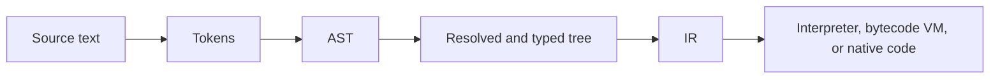

# Programming language design

A game that needs behaviour that is not compiled into the engine often grows a language: a script the designer can reload, a shader the material graph lowers to, a console command language, or a data format that acquired expressions. The work is the same as any language: decide what the programmer writes, what it means, how names and types are checked, how memory is owned, and whether the result is interpreted, compiled ahead of time, or compiled as it runs.

This page is those choices. Generating LLVM IR for a compiler is [LLVM](llvm.md). Loading and reloading C# as the script language is [assemblies](../csharp/assemblies/index.md) and [hosting from C++](../csharp/assemblies/hosting.md). [Roslyn](../csharp/roslyn/index.md) is the C# compiler as a library, not a design for a new language.

## When to invent a language

| Need | Prefer |
| --- | --- |
| Gameplay logic that non-engine programmers reload while the game runs | An existing language, hosted: C# as in [hosting from C++](../csharp/assemblies/hosting.md), or a small embeddable language |
| A data format that needs a little behaviour (damage formulae, encounter rules) | Data plus a tiny expression language, or a bytecode of a few opcodes, not a general-purpose language |
| A tool or material graph the user authors visually | A graph that lowers to a language you already compile; keep the graph as the source |
| Tight inner loops, or shaders | A compiled language, or the graphics API's shader language. A tree-walking interpreter will not do |
| One hook, or a handful of callbacks | A function pointer, a behaviour tree, or a table of function names. A language is more machinery than the hook |

Invent a language when the existing options force the wrong shape: the syntax is unreadable for the domain, the runtime is too heavy, or you cannot sandbox or serialise it. The cost is everything on this page, plus tooling — an editor, errors people can read, and a debugger. Bob Nystrom's [Crafting Interpreters](https://craftinginterpreters.com/) is a clear walk through a tree-walker and then a bytecode VM, and is the right length to read before writing either.

## Syntax and grammar

Syntax is what is legal to write. A **grammar** describes it: terminals (tokens the lexer produces) and rules that build larger phrases from smaller ones. Most programming languages are nearly context-free, which is why a recursive-descent or precedence-climbing parser can be written by hand and stay close to the grammar.

Write the grammar down before the parser. Ambiguity in the grammar becomes a fork in the parser that you will resolve ad hoc, and then cannot explain. Classic traps:

- **The dangling else.** `if A then if B then X else Y` — which `if` owns the `else`? Pick a rule (the inner `if`, almost always) and make the parser and the error messages agree with it.
- **Statement separators.** Newlines that sometimes end a statement and sometimes do not (as in JavaScript or Python) need an explicit rule, or the lexer has to insert tokens.
- **Whitespace and indentation.** Insignificant whitespace is easier to parse. Significant indentation is easier to write for some domains, and means the lexer must emit indent and dedent tokens, and must define tab width.
- **Semicolons and closing delimiters.** A language used in a game console, or typed one-liners, often wants optional semicolons. A language dumped by a tool wants a unique, boring syntax that pretty-prints stably.

Keep the surface small. One way to write a block, one way to declare a binding, one string literal form unless you have a reason for a second. Syntax sugar is compiled away; it is cheap only if the desugaring is obvious and does not change scoping or evaluation order.

## Lexing and parsing

A **lexer** (scanner) turns a character stream into tokens: identifiers, numbers, keywords, operators, and punctuation. It is the place to skip comments, to decide whether `>=` is one token or two, and to record source locations for later errors. Do not let the parser look at raw characters except in a few well-known cases (string interpolation, typeless sloppy modes), or you will have two places that disagree about what a token is.

A **parser** turns tokens into an **abstract syntax tree** (AST): a tree of language constructs, not of punctuation. `1 + 2 * 3` becomes an add node whose right child is a multiply, not a list of tokens. Keep the AST close to the language, not to the later IR. Locations live on the nodes, so later stages can still point at the source.

### Recursive descent

For statements, declarations, and anything that starts with a keyword, a **recursive-descent** parser is the usual choice: one function per grammar rule, each looking at the current token and calling the functions for the parts it needs.

```text
parse_statement():
    if peek is "if":    return parse_if()
    if peek is "while": return parse_while()
    if peek is "let":   return parse_let()
    return parse_expression_statement()

parse_if():
    take "if"
    condition = parse_expression()
    take "then"
    then_branch = parse_block()
    else_branch = parse_block() if peek is "else" else nothing
    return If(condition, then_branch, else_branch)
```

The functions are the grammar. Left recursion (`expr := expr + term`) would loop, so binary operators are not written that way.

### Pratt parsing and precedence climbing

Binary operators, unary prefix and postfix, and call or index syntax are handled more cleanly by a **Pratt parser**, also called **precedence climbing**. Each operator has a precedence and an associativity. The parser reads a prefix expression (a literal, a parenthesised expression, a unary prefix), then folds infix operators of high enough precedence into it.

```text
parse_expression(min_prec = 0):
    left = parse_prefix()                  // literal, ident, unary, "(" expr ")"
    while peek is an infix operator and prec(peek) >= min_prec:
        op = take()
        next_min = prec(op) + (1 if op is left-associative else 0)
        right = parse_expression(next_min)
        left = Binary(op, left, right)
    return left

parse_prefix():
    if peek is a unary operator:
        op = take()
        return Unary(op, parse_expression(prec(op)))
    if peek is "(":
        take "("
        e = parse_expression()
        take ")"
        return e
    if peek is a number or identifier:
        return take()
    error("expected an expression")
```

`a + b * c` parses the add only after `*` has consumed `b` and `c`, because `*` has higher precedence. Right-associative operators (`=`, `^`) pass the same precedence back down, so `a = b = c` becomes `a = (b = c)`.

| Approach | Good for | Weakness |
| --- | --- | --- |
| Recursive descent | Keyword-led constructs, a grammar you can read off the functions | Awkward for operators; left recursion has to be rewritten |
| Pratt / precedence climbing | Operators, unary forms, calls, indexing | The keyword parts of the language still want recursive descent |
| Parser generator (PEG, LALR) | A large or frequently changing grammar | Error messages and recovery are harder to control; a game-script grammar is rarely large enough to need one |
| Pratt for everything, including statements | A very small expression language | Statements still parse more clearly as recursive descent |

A practical parser is recursive descent for declarations and statements, and Pratt for expressions. On a syntax error, report one location, skip to a synchronisation point (a semicolon, a `}`, a keyword that starts a statement), and continue, so one typo does not produce twenty messages.

## Name resolution and scoping

After parsing, every mention of a name has to be bound to a declaration. **Lexical scoping** (a name refers to the declaration in the nearest enclosing block) is the default that people can reason about. **Dynamic scoping** (a name refers to the caller's binding) still appears in some console languages and in poorly designed macro systems; it makes behaviour depend on the call stack, and is almost never what you want for game scripts.

```text
resolve(node, scope):
    if node is a declaration of name:
        define name in scope, or error if it is already declared here
        resolve the initialiser in scope           // or in a scope that does not yet contain name
    if node is a use of name:
        bind it to the declaration found by walking out of scope, or error
    if node is a block or function:
        resolve each child in a child scope
```

Decisions that will bite you later:

- **Shadowing.** Allowing an inner `let x` to hide an outer `x` is convenient and also a source of bugs. Some languages forbid shadowing in the same function, and allow it across function boundaries.
- **Forward references.** Must a function be declared above its first call? A second pass over declarations, or a two-phase resolve (declare all names in the scope, then resolve bodies), lets people write mutually recursive functions. Types and constants often need the same treatment.
- **Modules.** A name is either local to a file, imported, or exported. Resolve imports before bodies, and reject cycles or define the order they initialise in. A game that hot-reloads one module must be able to re-resolve the modules that imported it.
- **Overloading and methods.** Binding by name is not enough: you also need the type of the arguments, which means name resolution and type checking interleave, or you collect candidates and pick during typing.

Record the binding on the AST (a pointer or an index to the declaration). Later stages should not look up names in a string table again; that work is done.

## Type systems

A **type** is a predicate on a value: this is an integer, this is a handle to an entity, this is a function from a vector to a bool. The type system is the set of rules that assign types and reject programs.

| Choice | Meaning | Typical use |
| --- | --- | --- |
| Static | Types are checked before the code runs. A mismatch is a compile error | Engines, shaders, anything you want to run without per-operation checks |
| Dynamic | Values carry a type, and operations check it at run time | Small scripts, exploratory tools. You will still want a few static checks for APIs you expose |
| Nominal | Two types are the same when they have the same declared name (`PlayerId` is not `EntityId`, even if both are integers) | Handles, ids, and any integer you do not want to mix |
| Structural | Two types are the same when their shape matches (two records with the same fields) | Anonymous records, shader vertex layouts, interchange formats |
| Inference | The compiler fills in types you omit, from context and from initialisers | Local variables, lambdas. Whole-program inference is harder to report errors for |
| Generics / polymorphism | A function or type is parameterised by other types (`List<T>`, `map(f, xs)`) | Containers and reusable numeric code. Start with monomorphisation: generate a copy per instantiation, like C++ templates or Rust |

Static and dynamic are not a single switch. A statically typed language can have a `dynamic` or `any` escape, and a dynamic language can type-check calls into the engine. For a game script, a useful middle is static types at the boundary (the engine API, component fields) and inference inside functions.

Nominal types are how you stop a `Health` and a `Meters` from being added. They are cheap: a distinct name over the same representation, erased in the IR.

Generics need a policy for what happens at compile time. **Monomorphisation** generates specialised code and is fast at run time, which is what you want for maths and for ECS queries; it costs compile time and code size. A **boxed** or dictionary-passing implementation (as in Java generics, or a fat pointer) shares one copy of the code and is slower. Mixed strategies exist; pick one per construct rather than inventing a third.

Type errors should point at the source and say what was expected and what was found. Inference that fails deep in a chain of calls needs a way to show the chain, or people will not trust it.

## Semantics

Syntax says what is written. **Semantics** say what it does.

**Evaluation order.** For `f(a(), b())`, do you evaluate `a` then `b`, or the other way, and is it defined at all? Left-to-right is the choice people can remember. Short-circuit `and` and `or` must be specified. If you allow overloaded `and`, decide whether it still short-circuits.

**Value versus reference.** When you write `let b = a` or pass `a` to a function, is `b` a copy, or does it alias `a`? Mixed models are normal: numbers and small structs are values, objects and arrays are references. The C# version of this split, and the cost of getting it wrong, is on [structs, Span, and ref](../csharp/performance/structs-span.md) and [allocations](../csharp/performance/allocations.md). In a scripting language, defaulting to reference semantics for every aggregate is simple and then painful when a designer writes `b = a; b.x = 1` and `a` changes too. Defaulting to value semantics for small structs, and making reference types explicit, matches how people think about positions, colours, and damage events.

**Expressions versus statements.** An expression produces a value; a statement does not. Some languages make almost everything an expression (`if` returns a value, blocks return the last expression). That is convenient, and it means you need a rule for a block that ends in a declaration, and for an `if` whose branches have different types. A statement-oriented language is slightly more tedious and much easier to type-check. A small expression language for data (a formula on a character sheet) can be expressions only, with no statements at all.

**Errors.** Decide how a failure is reported, and be consistent:

| Model | The caller sees | Cost |
| --- | --- | --- |
| Exceptions, or a panic that unwinds | Control jumps to a handler, or the script dies | Simple to throw; unwinding through engine frames needs care, and a hot path that throws is slow |
| Result types (`Ok(v)` or `Err(e)`) | A value they must unwrap or propagate | Explicit, easy to JIT, verbose without syntax help |
| Sentinels (`null`, `-1`, `NaN`) | A value in-band | Easy to ignore; `NaN` poisoning can be a feature in maths code |
| Abort the script, log, and continue the game | Nothing; the hook stops | The only acceptable default when the script is content, not engine code |

Game scripts should not be able to unwind through the engine unnoticed. Catch at the boundary, log a source location, and leave the entity in a defined state.

Specify integer overflow (wrap, saturate, trap, or undefined), division by zero, and what a dangling handle does. "Undefined" is a compiler-optimisation gift and a designer-facing bug. Wrap or trap, and document it.

## Memory model

The memory model is who allocates, who frees, and whether two names can alias the same storage.

| Model | Who frees | Pause and overhead | Alias story | Typical use |
| --- | --- | --- | --- | --- |
| Manual (`malloc`/`free`, or an arena) | The programmer, or the arena at the end of a scope or frame | None beyond the allocator. Arenas are cheap if lifetimes are shared | Anything can alias; use-after-free is on you | Engine runtimes, frame-scoped scratch, see [free lists](../data-structures/free-list.md) |
| Tracing GC | A collector, when it can prove an object is unreachable | Allocations are cheap; collections hitch if you allocate every frame | References are safe; the GC must see every pointer, including those on the native side of a boundary | Designers' scripts, C# game code. The costs are on [allocations and the GC](../csharp/performance/allocations.md) |
| Reference counting | When the last count drops to zero | Predictable, per-assignment work; cycles leak unless you have a cycle collector or weak refs | Same safety as GC for acyclic graphs; counters are a write on every copy | Trees of assets, UI, shared resources with clear ownership |
| Ownership and borrowing | The owner, at the end of its scope. Borrows are checked so they cannot outlive it | None at run time if the checks are static | Mutation is exclusive, or sharing is immutable | A compiled language you control; a lot of compiler work |
| Value types | Nothing: the value lives in its slot, and a copy is a copy | No heap, unless a field is a reference | No alias of the value itself | Vectors, colours, handles, small parameter blocks |

For an embeddable game language, a tracing GC or reference counting is the usual choice, because authors will not free correctly. The engine then has a boundary problem: a script handle to an engine object must not keep a dangling pointer after the object is destroyed. The same handle-and-generation pattern used in [handle tables](../data-structures/handle-table.md) and in [hosting C#](../csharp/assemblies/hosting.md#script-objects-and-the-engine) is the right one: scripts hold ids, not raw pointers, and a use after destroy fails a lookup.

If the language is compiled and written by engine programmers, ownership or arenas will fit the rest of the engine better than a GC. Value types should be first-class in either case: a `Vector3` that heaps on every add will show up in any profiler.

A moving GC (it relocates objects) cannot let the engine hold a raw pointer into script memory across a collection. Pin, or copy out, or do not move. This is the same constraint as [pointers and native memory](../csharp/performance/memory.md) on the C# side.

## The compile pipeline

Every implementation is a pipeline, even a Saturday-night tree-walker. The stages after the AST can be thin or thick, but the shape is stable:



Name resolution and type checking can rewrite the tree or produce a new one. They should not be skipped "until later" in a language people ship content in; a type error at run time in a shipped encounter is a worse process than a compile error in the editor.

**IR** (intermediate representation) is a representation designed for the remaining work, not for humans to write. It might be a flattened bytecode, a graph of SSA values (as in [LLVM](llvm.md)), or still a tree with types filled in. Lowering to IR is the point at which language features disappear: `foreach` becomes a loop, methods become function calls with an extra argument, and generics are monomorphised or boxed.

| Implementation | What runs | When it is the right tool |
| --- | --- | --- |
| Tree-walking interpreter | A `switch` over AST node kinds, recursively | A calculator, a conditional in a data file, a first prototype. Too slow for per-frame logic on many entities |
| Bytecode VM | A compact instruction stream and a loop that dispatches it. Locals in slots, not on the host call stack | General game scripts. You control the instruction set, can snapshot it, and can JIT later the hot functions |
| AOT compilation | Ahead of time to native code, or to a host language you already compile | Shipping a player build, shaders, tools that can wait for a compile. The [LLVM](llvm.md) path, or a lower to C# / C++ |
| JIT compilation | Compile a function when it is first called, or when it has been hot, then call the machine code | Editors, REPLs, and languages where the program is not known at pack time. LLVM's ORC JIT, or a specialised JIT |

A bytecode VM is the usual destination for a game-script language. The instruction set can stay small (loads, stores, arithmetic, calls, jumps). An interpreter of that bytecode is a few hundred lines, is portable, and is easy to sandbox: the only operations are the ones you implemented. You can compile the same bytecode to native code later without changing the language.

AOT or JIT become worth it when profiling says the VM is the cost, or when the language is a shader or a numerical kernel. Do not start there. The frontend (lexer through typed AST) is the same in every column of the table above; what changes is the backend. [LLVM](llvm.md) is a backend you can adopt once you have an IR of your own, or once you have decided to emit LLVM IR directly from the typed tree.

Hot reload follows from the pipeline. Re-lex, re-parse, and re-type the changed module; reject it if it fails; swap the bytecode or the JIT'd functions; and decide what happens to live state (keep it when the layout of a script object has not changed, otherwise drop or migrate). The C# version of that problem is [reloading scripts](../csharp/assemblies/hosting.md#reloading-scripts).

!!! warning "Common pitfalls"

    Writing the parser before the grammar produces a language only the parser accepts, and that nobody can specify.

    A tree-walking interpreter on the AST is fine for a tool; on a gameplay hook that runs for thousands of entities it will be the profile. Lower to bytecode, or to native code, before you tune the tree-walker.

    Dynamic scoping, implicit globals, and "undeclared names become locals" make typo-level bugs into run-time state. Require declarations, and resolve names before execution.

    Letting script values hold raw pointers to engine objects will use memory after free the first time a scene unloads. Hand out handles, and fail the lookup when the generation does not match.

    Exceptions that unwind out of a script into engine code skip destructors and leave locks and debug scopes held. Catch at the call boundary.

    Changing evaluation order, integer overflow, or value-versus-reference between the editor interpreter and the shipped compiler splits the player from the tools. One semantics, shared tests, even if the backends differ.
