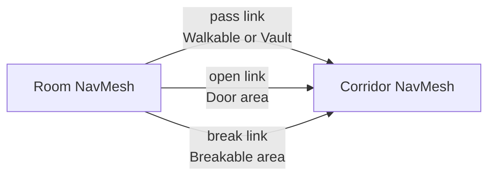

# Navigation scenarios

Situations a plain `SetDestination` handles badly, on top of the `NavMeshAgent` from [enemy behaviour](../enemy.md). Each page is one scenario. They share the area types and the agent profile below.

| Page | Scenario |
| --- | --- |
| [Doors and windows](doors-windows.md) | Passing through openings whose state changes: open, closed, locked, broken. Opening a door or climbing a window as part of the path. |
| [Breakable obstacles](breakable.md) | Breaking a door, wall, or barricade when there is no other way in, or when breaking is quicker than walking round. |
| [Large targets](large-targets.md) | Walking up to something bigger than the agent, such as a vehicle, a building, or a boss, and spreading attackers around it. |
| [Stuck agents and chokepoints](stuck.md) | Noticing an agent is not getting anywhere, recovering, and queueing at doorways. |

## Openings are links

The pages model every opening the same way. The baked NavMesh has a gap where the door, window, or weak wall is, and one or more `NavMeshLink`s cross the gap. Which links are switched on decides who can pass and at what cost. The pathfinder then makes the choice between opening, breaking, and walking round, because those are just links with different costs.



A `NavMeshObstacle` that carves is the other common tool. It removes the mesh under it, so agents walk round it, but no path can ever go through it. Use carving for things agents only avoid, such as crates, cars, and a burning area. Use links for things agents might go through.

## Area types

Add these in **Window → AI → Navigation**, on the **Areas** tab. The built-in ones are **Walkable** (0), **Not Walkable** (1), and **Jump** (2).

| Area | Used by | Default cost |
| --- | --- | --- |
| **Door** | Links that need a door opened first. | 1. Each agent profile sets its own. |
| **Vault** | Links through windows and over low walls. | 1 |
| **Breakable** | Links that need something broken first. The [break cost](breakable.md#cost) is set on the link itself. | 1 |

Area cost multiplies distance. A path through 2 metres of area with cost 3 counts as 6 metres. A link's cost is its length times its area's cost. With **Cost Override** ticked, the override value is used in place of the area's cost, still times the length, and per-agent area costs no longer apply to that link.

## Agent profile

Different agents treat the same opening differently. A survivor opens doors. A zombie cannot open them but can break them. A dog can do neither. A profile asset holds that, and a component applies it to the agent.

```csharp
using System;
using UnityEngine;
using UnityEngine.AI;

/// <summary>
/// Which areas an agent may use, and what each costs it.
/// </summary>
[CreateAssetMenu(fileName = "NavProfile", menuName = "Game/AI/Nav Profile")]
public class NavProfile : ScriptableObject
{
    [Serializable]
    public struct AreaCost
    {
        public string area;
        [Tooltip("Off: the agent never paths through this area.")]
        public bool allowed;
        [Min(1f)] public float cost;
    }

    [SerializeField] AreaCost[] areas =
    {
        new AreaCost { area = "Walkable", allowed = true, cost = 1f },
        new AreaCost { area = "Door", allowed = true, cost = 4f },
        new AreaCost { area = "Vault", allowed = true, cost = 3f },
        new AreaCost { area = "Breakable", allowed = false, cost = 1f },
    };

    [SerializeField] bool canOpenDoors = true;
    [SerializeField] bool canVault = true;
    [SerializeField] bool canBreak;
    [Tooltip("Damage per second against openings and obstacles.")]
    [SerializeField] float breakDamagePerSecond = 10f;

    public bool CanOpenDoors => canOpenDoors;
    public bool CanVault => canVault;
    public bool CanBreak => canBreak;
    public float BreakDamagePerSecond => breakDamagePerSecond;

    public void ApplyTo(NavMeshAgent agent)
    {
        int mask = 0;
        foreach (AreaCost entry in areas)
        {
            int index = NavMesh.GetAreaFromName(entry.area);
            if (index < 0)
            {
                Debug.LogWarning("Unknown NavMesh area '" + entry.area + "'.", this);
                continue;
            }

            if (entry.allowed)
                mask |= 1 << index;
            agent.SetAreaCost(index, entry.cost);
        }
        agent.areaMask = mask;
    }
}
```

```csharp
using UnityEngine;
using UnityEngine.AI;

[RequireComponent(typeof(NavMeshAgent))]
public class NavProfileUser : MonoBehaviour
{
    [SerializeField] NavProfile profile;

    public NavProfile Profile => profile;

    // Area costs set on an agent reset when it is enabled or disabled. Apply them every time.
    void OnEnable() => profile.ApplyTo(GetComponent<NavMeshAgent>());
}
```

- Areas left out of the list keep the project default cost and are left out of the mask.
- A cost below 1 is not allowed. Keep **Walkable** at 1 and raise the others.
- **Door** cost is the time to open, as distance. Opening for 0.8 seconds at 3.5 metres per second is about 3 metres, so on a 0.5 metre link the area cost is about (0.5 + 2.8) / 0.5 ≈ 7. Round numbers are fine. The aim is that a survivor walks 3 metres round an open archway rather than open a door beside it.

## Setup

1. Install **AI Navigation** 2.x and bake a `NavMeshSurface`, as on [enemy behaviour](../enemy.md#setup).
2. Add the three areas above.
3. Make a profile per kind of agent, and add `NavProfileUser` next to each `NavMeshAgent`.
4. Set up openings as on [doors and windows](doors-windows.md).
