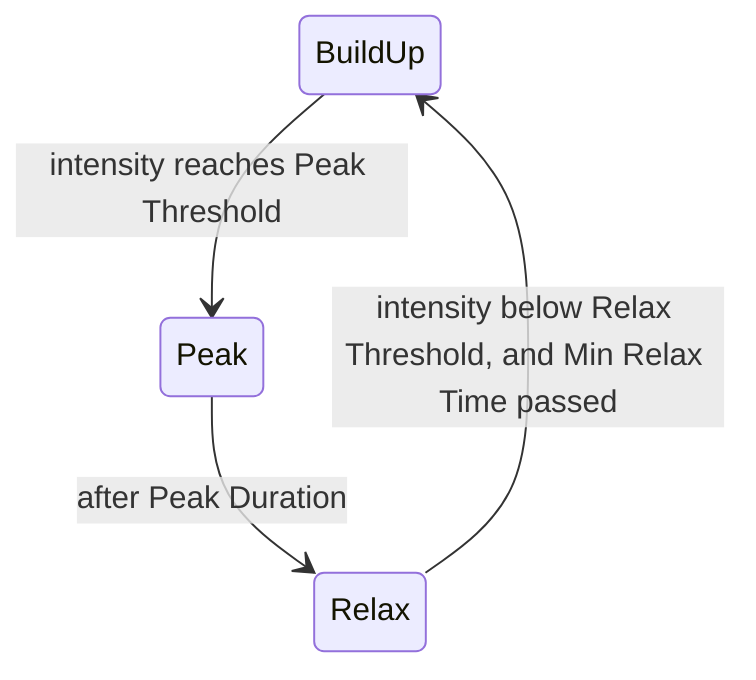

# Continuous spawning

Spawning without rounds. Three methods, each a small component on top of the `EnemySpawner` from [enemy waves](waves.md), which picks off-screen points and tracks who is alive:

| Method | Spawns when | Good for |
| --- | --- | --- |
| **Timed trickle** | Always, at a rate that rises over time. | Survivor-likes and horde modes, where pressure should climb steadily. |
| **Proximity zones** | The player comes near a zone. | Open levels and corridors, where enemies belong to places. |
| **Director** | The player's recent stress is low enough. | Co-op and campaign levels that should breathe: build-up, peak, relax. |

They combine. A level can have zones for its set pieces and a director topping up the space between.

## Timed trickle

Two curves over minutes since the component was enabled: enemies per minute, and the alive cap. Each frame, the rate adds to an owed count:

\[
\text{owed} \mathrel{+}= \frac{\text{rate}(t)}{60}\,\Delta t
\]

and one enemy is spawned for each whole unit owed, while the alive count is under the cap. The owed count is capped at a few, so time spent at the cap does not bank a burst for later.

Entries unlock at a minute and have a weight, so harder enemies join the mix as the run goes on.

## Proximity zones

A zone is a trigger-free object with a radius and some child spawn points. When the player enters the **Activation Radius**, it spawns its enemies at its own points that the camera cannot see. With **Respawn** on, it keeps that many alive, refilling one at a time after **Respawn Delay**. With it off, it fires once.

A zone only spawns while the player is inside the radius, so a cleared area stays cleared when the player leaves and comes back, unless it respawns.

## Director

A director tracks how stressed the player is, as one number, and only spawns while it is low. It moves through three phases, an idea from Left 4 Dead's AI director:



- **Build-up**: spawn at **Build Up Rate** per minute.
- **Peak**: keep spawning for **Peak Duration** seconds so the high lasts.
- **Relax**: no spawns. Intensity decays. The player gets a breather.

Intensity is in \([0, 1]\). It rises when the player takes damage, in proportion to the damage as a fraction of max health, and when an enemy dies within **Near Radius** of the player. It decays at **Decay Per Second**, but only while no enemy is within **Near Radius**: a fight in progress does not count as calm.

The thresholds and times are the tuning. A peak threshold of 0.7, 4 seconds of peak, and 25 seconds minimum relax gives a fight roughly every 40 to 60 seconds.

## Setup

1. Set up `SpawnPoint`s and an `EnemySpawner` as on the [enemy waves](waves.md) page.
2. **Trickle:** put `TrickleSpawner` on the spawner object. Fill **Entries** and shape the two curves. The defaults go from 10 to 60 enemies a minute, and a cap of 10 to 120, over 10 minutes.
3. **Zones:** for each area, an empty object with `ProximitySpawner`, child objects as its spawn positions, and the spawner assigned. Set the radius, count, and prefabs.
4. **Director:** put `SpawnDirector` on the spawner object. Assign the player's `Health` and fill **Entries**.

## Scripts

### Weighted pick

Shared by the trickle and the director.

```csharp
using System;
using UnityEngine;

[Serializable]
public class TimedSpawnEntry
{
    public GameObject prefab;
    [Min(0f)] public float weight = 1f;
    [Tooltip("Minutes after start before this enemy can appear.")]
    [Min(0f)] public float fromMinute;
}

public static class SpawnPick
{
    /// <summary>A weighted pick among the entries unlocked at this minute, or null.</summary>
    public static GameObject Pick(TimedSpawnEntry[] entries, float minute)
    {
        float total = 0f;
        foreach (TimedSpawnEntry entry in entries)
        {
            if (entry.prefab != null && entry.fromMinute <= minute)
                total += entry.weight;
        }
        if (total <= 0f)
            return null;

        float roll = UnityEngine.Random.value * total;
        GameObject last = null;
        foreach (TimedSpawnEntry entry in entries)
        {
            if (entry.prefab == null || entry.fromMinute > minute || entry.weight <= 0f)
                continue;
            if (roll < entry.weight)
                return entry.prefab;
            roll -= entry.weight;
            last = entry.prefab;
        }
        return last;
    }
}
```

### Trickle spawner

```csharp
using UnityEngine;

/// <summary>
/// Spawns continuously at a rate and cap that follow curves over minutes.
/// </summary>
[RequireComponent(typeof(EnemySpawner))]
public class TrickleSpawner : MonoBehaviour
{
    [SerializeField] TimedSpawnEntry[] entries = System.Array.Empty<TimedSpawnEntry>();

    [Tooltip("Enemies per minute, by minutes since enabled.")]
    [SerializeField] AnimationCurve perMinute = AnimationCurve.Linear(0f, 10f, 10f, 60f);

    [Tooltip("Most alive at once, by minutes since enabled.")]
    [SerializeField] AnimationCurve aliveCap = AnimationCurve.Linear(0f, 10f, 10f, 120f);

    [Tooltip("Most spawns owed at once, so time at the cap does not bank a burst.")]
    [SerializeField] float maxOwed = 3f;

    EnemySpawner _spawner;
    float _startTime;
    float _owed;

    public float Minutes => (Time.time - _startTime) / 60f;

    void Awake()
    {
        _spawner = GetComponent<EnemySpawner>();
    }

    void OnEnable()
    {
        _startTime = Time.time;
        _owed = 0f;
    }

    void Update()
    {
        float minutes = Minutes;
        _owed = Mathf.Min(_owed + perMinute.Evaluate(minutes) / 60f * Time.deltaTime, maxOwed);
        int cap = Mathf.RoundToInt(aliveCap.Evaluate(minutes));

        while (_owed >= 1f && _spawner.Alive < cap)
        {
            GameObject prefab = SpawnPick.Pick(entries, minutes);
            if (prefab == null || !_spawner.TrySpawn(prefab, out _))
                break;
            _owed -= 1f;
        }
    }
}
```

### Proximity spawner

```csharp
using System.Collections.Generic;
using UnityEngine;
using UnityEngine.AI;

/// <summary>
/// Spawns its enemies at its child positions when the player comes within range.
/// </summary>
public class ProximitySpawner : MonoBehaviour
{
    [SerializeField] EnemySpawner spawner;
    [SerializeField] GameObject[] prefabs = System.Array.Empty<GameObject>();
    [Min(1)] [SerializeField] int count = 4;
    [SerializeField] float activationRadius = 25f;

    [Tooltip("Keep Count alive while the player is in range. Off fires once.")]
    [SerializeField] bool respawn;
    [SerializeField] float respawnDelay = 6f;

    readonly List<Health> _mine = new List<Health>();
    readonly List<Transform> _points = new List<Transform>();
    bool _fired;
    float _nextSpawn;

    void Awake()
    {
        foreach (Transform child in transform)
            _points.Add(child);
        if (_points.Count == 0)
            _points.Add(transform);
    }

    void Update()
    {
        if (spawner == null || spawner.Player == null || prefabs.Length == 0)
            return;

        float range = activationRadius * activationRadius;
        if ((spawner.Player.position - transform.position).sqrMagnitude > range)
            return;

        _mine.RemoveAll(enemy => enemy == null || enemy.IsDead);

        if (!_fired)
        {
            _fired = true;
            for (int i = 0; i < count; i++)
                SpawnOne();
            _nextSpawn = Time.time + respawnDelay;
            return;
        }

        if (respawn && _mine.Count < count && Time.time >= _nextSpawn)
        {
            if (SpawnOne())
                _nextSpawn = Time.time + respawnDelay;
        }
    }

    bool SpawnOne()
    {
        // Start at a random point and take the first one the camera cannot see.
        int start = Random.Range(0, _points.Count);
        for (int i = 0; i < _points.Count; i++)
        {
            Vector3 position = _points[(start + i) % _points.Count].position;
            if (spawner.IsVisible(position))
                continue;

            if (NavMesh.SamplePosition(position, out NavMeshHit hit, 2f, NavMesh.AllAreas))
                position = hit.position;

            GameObject prefab = prefabs[Random.Range(0, prefabs.Length)];
            if (spawner.TrySpawnAt(prefab, position, out Health enemy))
            {
                if (enemy != null)
                    _mine.Add(enemy);
                return true;
            }
            return false;
        }
        return false;
    }

    void OnDrawGizmosSelected()
    {
        Gizmos.color = new Color(1f, 0.8f, 0.2f, 0.6f);
        Gizmos.DrawWireSphere(transform.position, activationRadius);
    }
}
```

On the first activation, points in view are skipped. If every point is in view, fewer than **Count** spawn, and with **Respawn** on the zone fills up as the player looks away.

### Spawn director

```csharp
using UnityEngine;

/// <summary>
/// Paces spawns by player stress: build up, hold a peak, then relax.
/// </summary>
[RequireComponent(typeof(EnemySpawner))]
public class SpawnDirector : MonoBehaviour
{
    public enum Phase
    {
        BuildUp,
        Peak,
        Relax
    }

    [SerializeField] Health playerHealth;
    [SerializeField] TimedSpawnEntry[] entries = System.Array.Empty<TimedSpawnEntry>();

    [Header("Intensity")]
    [Tooltip("Intensity added per full health bar of damage taken.")]
    [SerializeField] float damageWeight = 1.5f;
    [Tooltip("Intensity added when an enemy dies within Near Radius.")]
    [SerializeField] float nearKill = 0.04f;
    [SerializeField] float nearRadius = 10f;
    [SerializeField] float decayPerSecond = 0.05f;

    [Header("Phases")]
    [SerializeField] float buildUpRate = 30f;
    [Range(0f, 1f)] [SerializeField] float peakThreshold = 0.7f;
    [SerializeField] float peakDuration = 4f;
    [Range(0f, 1f)] [SerializeField] float relaxThreshold = 0.2f;
    [SerializeField] float minRelaxTime = 25f;

    public Phase Current { get; private set; } = Phase.BuildUp;
    public float Intensity { get; private set; }

    EnemySpawner _spawner;
    float _phaseStart;
    float _owed;
    float _startTime;

    void Awake()
    {
        _spawner = GetComponent<EnemySpawner>();
    }

    void OnEnable()
    {
        _startTime = Time.time;
        _phaseStart = Time.time;
        Current = Phase.BuildUp;
        Intensity = 0f;
        _owed = 0f;

        if (playerHealth != null)
            playerHealth.Damaged += OnPlayerDamaged;
        _spawner.Killed += OnEnemyKilled;
    }

    void OnDisable()
    {
        if (playerHealth != null)
            playerHealth.Damaged -= OnPlayerDamaged;
        _spawner.Killed -= OnEnemyKilled;
    }

    void OnPlayerDamaged(DamageInfo info, float amount)
    {
        if (playerHealth.Max > 0f)
            AddIntensity(amount / playerHealth.Max * damageWeight);
    }

    void OnEnemyKilled(Health enemy)
    {
        if (enemy != null && _spawner.Player != null &&
            (enemy.transform.position - _spawner.Player.position).sqrMagnitude <= nearRadius * nearRadius)
            AddIntensity(nearKill);
    }

    void AddIntensity(float amount)
    {
        Intensity = Mathf.Clamp01(Intensity + amount);
    }

    void Update()
    {
        if (!EnemiesNear())
            Intensity = Mathf.Max(0f, Intensity - decayPerSecond * Time.deltaTime);

        float inPhase = Time.time - _phaseStart;
        switch (Current)
        {
            case Phase.BuildUp:
                SpawnAtRate();
                if (Intensity >= peakThreshold)
                    Enter(Phase.Peak);
                break;

            case Phase.Peak:
                SpawnAtRate();
                if (inPhase >= peakDuration)
                    Enter(Phase.Relax);
                break;

            case Phase.Relax:
                if (inPhase >= minRelaxTime && Intensity <= relaxThreshold)
                    Enter(Phase.BuildUp);
                break;
        }
    }

    void Enter(Phase phase)
    {
        Current = phase;
        _phaseStart = Time.time;
        _owed = 0f;
    }

    void SpawnAtRate()
    {
        _owed = Mathf.Min(_owed + buildUpRate / 60f * Time.deltaTime, 3f);
        float minutes = (Time.time - _startTime) / 60f;
        while (_owed >= 1f)
        {
            GameObject prefab = SpawnPick.Pick(entries, minutes);
            if (prefab == null || !_spawner.TrySpawn(prefab, out _))
                break;
            _owed -= 1f;
        }
    }

    bool EnemiesNear()
    {
        Transform player = _spawner.Player;
        if (player == null)
            return false;

        // Any live tracked enemy inside the radius counts as pressure.
        float range = nearRadius * nearRadius;
        foreach (Health enemy in _spawner.AliveEnemies)
        {
            if (enemy != null && !enemy.IsDead && (enemy.transform.position - player.position).sqrMagnitude <= range)
                return true;
        }
        return false;
    }
}
```

!!! warning "Common pitfalls"

    The trickle's clock starts in `OnEnable`. Disabling it to pause restarts the curves from minute 0. Pause with `Time.timeScale` instead.

    Without the cap on the owed count, a trickle that sits at its alive cap for a minute spawns a minute's worth the moment room appears.

    A proximity zone whose points are all in view on activation spawns nothing until the player looks away. Put some points behind cover or around corners.

    A director whose decay runs during fights never reaches the relax threshold mid-fight, but one whose decay never runs never relaxes. The near-enemy check is what separates the two. Tune **Near Radius** to the range at which enemies are a threat.

    Intensity from damage scales with the player's max health. A buff that doubles health halves the stress from the same hits, which is usually what you want.
