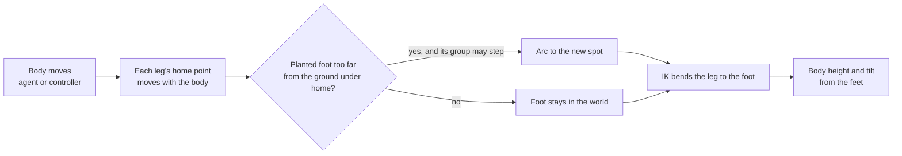

# Procedural legs

Legs with no walk cycle. Each foot stays planted in the world until the body has moved too far from it, then steps to a new spot found by a raycast, in an arc. Legs step in alternating groups, so the creature never lifts every foot at once. The body's height and tilt follow the feet. IK bends each leg to reach its foot.



## Rig

- The body moves on a root object, driven by a `NavMeshAgent` or a controller. A **Body** child holds the skeleton and takes the height and tilt, so the root stays level for the agent.
- Each leg has an IK constraint from **Animation Rigging**: a **Two Bone IK Constraint** for two-segment legs, such as a mech or a crab, or a **Chain IK Constraint** for longer ones, such as a spider. Its target is an empty `FootTarget` object **outside the body's hierarchy**, so it does not move with the body.
- Each leg has a **Home**: an empty child of the root, placed where that foot rests when standing. Homes move with the body; feet do not.

## Legs

```csharp
using System.Collections;
using UnityEngine;

/// <summary>
/// Plants feet in the world and steps them when the body moves away. Groups step in turn.
/// Each foot target is an IK constraint's target.
/// </summary>
public class ProceduralLegs : MonoBehaviour
{
    [System.Serializable]
    public class Leg
    {
        public Transform home;
        public Transform footTarget;
        [Tooltip("Legs in the same group step together. Alternate groups: 0, 1, 0, 1 round the body.")]
        public int group;
        [HideInInspector] public bool stepping;
        [HideInInspector] public Vector3 planted;
    }

    [SerializeField] Leg[] legs;
    [SerializeField] Transform body;
    [SerializeField] LayerMask ground = ~0;
    [SerializeField] float castHeight = 1.5f;
    [SerializeField] float castDepth = 2f;
    [Tooltip("How far the ground under a home may get from its planted foot before the foot steps.")]
    [SerializeField] float stepDistance = 0.6f;
    [SerializeField] float stepTime = 0.15f;
    [SerializeField] float stepHeight = 0.25f;
    [Tooltip("Seconds of velocity to step ahead by, so feet land in front of a moving body.")]
    [SerializeField] float lead = 0.2f;

    [Header("Body")]
    [SerializeField] float bodyHeight = 0.6f;
    [SerializeField] float bodyFollow = 10f;

    Vector3 _lastPosition;
    Vector3 _velocity;
    int _groupToStep;

    void Start()
    {
        _lastPosition = transform.position;
        foreach (Leg leg in legs)
        {
            leg.planted = Ground(leg.home.position, out Vector3 point, out _) ? point : leg.home.position;
            leg.footTarget.position = leg.planted;
        }
    }

    void Update()
    {
        float dt = Time.deltaTime;
        if (dt > 0f)
            _velocity = (transform.position - _lastPosition) / dt;
        _lastPosition = transform.position;

        // Only one group steps at a time, and the next group waits until it has landed.
        if (!AnyStepping())
        {
            bool groupStepped = false;
            foreach (Leg leg in legs)
            {
                if (leg.group != _groupToStep)
                    continue;
                Vector3 predicted = leg.home.position + _velocity * lead;
                if (!Ground(predicted, out Vector3 spot, out _))
                    continue;
                if ((spot - leg.planted).sqrMagnitude > stepDistance * stepDistance)
                {
                    StartCoroutine(Step(leg, spot));
                    groupStepped = true;
                }
            }
            if (groupStepped || !NeedsStep(_groupToStep))
                _groupToStep = (_groupToStep + 1) % GroupCount();
        }

        foreach (Leg leg in legs)
        {
            if (!leg.stepping)
                leg.footTarget.position = leg.planted;
        }

        PlaceBody(dt);
    }

    IEnumerator Step(Leg leg, Vector3 to)
    {
        leg.stepping = true;
        Vector3 from = leg.planted;
        for (float t = 0f; t < 1f; t += Time.deltaTime / stepTime)
        {
            Vector3 p = Vector3.Lerp(from, to, t);
            p.y += stepHeight * Mathf.Sin(t * Mathf.PI); // lift in an arc
            leg.footTarget.position = p;
            yield return null;
        }
        leg.planted = to;
        leg.footTarget.position = to;
        leg.stepping = false;
    }

    void PlaceBody(float dt)
    {
        // Height: average foot height. Tilt: the plane through front and back, left and right feet.
        Vector3 sum = Vector3.zero, front = Vector3.zero, back = Vector3.zero, left = Vector3.zero, right = Vector3.zero;
        int f = 0, b = 0, l = 0, r = 0;
        foreach (Leg leg in legs)
        {
            Vector3 foot = leg.footTarget.position;
            sum += foot;
            Vector3 local = transform.InverseTransformPoint(leg.home.position);
            if (local.z >= 0f) { front += foot; f++; } else { back += foot; b++; }
            if (local.x < 0f) { left += foot; l++; } else { right += foot; r++; }
        }
        if (legs.Length == 0)
            return;

        Vector3 up = transform.up;
        if (f > 0 && b > 0 && l > 0 && r > 0)
        {
            Vector3 forwardAxis = front / f - back / b;
            Vector3 rightAxis = right / r - left / l;
            up = Vector3.Cross(forwardAxis, rightAxis).normalized;
            if (Vector3.Dot(up, transform.up) < 0f)
                up = -up;
        }

        float k = 1f - Mathf.Exp(-bodyFollow * dt);
        Vector3 targetPosition = sum / legs.Length + up * bodyHeight;
        body.position = Vector3.Lerp(body.position, targetPosition, k);
        Quaternion targetRotation = Quaternion.FromToRotation(transform.up, up) * transform.rotation;
        body.rotation = Quaternion.Slerp(body.rotation, targetRotation, k);
    }

    bool Ground(Vector3 at, out Vector3 point, out Vector3 normal)
    {
        Vector3 up = transform.up;
        if (Physics.Raycast(at + up * castHeight, -up, out RaycastHit hit, castHeight + castDepth, ground, QueryTriggerInteraction.Ignore))
        {
            point = hit.point;
            normal = hit.normal;
            return true;
        }
        point = at;
        normal = up;
        return false;
    }

    bool AnyStepping()
    {
        foreach (Leg leg in legs)
        {
            if (leg.stepping)
                return true;
        }
        return false;
    }

    bool NeedsStep(int group)
    {
        foreach (Leg leg in legs)
        {
            if (leg.group == group && Ground(leg.home.position + _velocity * lead, out Vector3 spot, out _)
                && (spot - leg.planted).sqrMagnitude > stepDistance * stepDistance)
                return true;
        }
        return false;
    }

    int GroupCount()
    {
        int max = 0;
        foreach (Leg leg in legs)
            max = Mathf.Max(max, leg.group);
        return max + 1;
    }
}
```

- **Lead** puts the step ahead of a moving body. Without it, feet land under where the body was and trail behind at speed.
- **Step distance** and **step time** set the gait. Short and quick is a skittering spider; long and slow is a heavy mech. A step must finish before the body moves another step distance, or the legs fall behind: `stepTime < stepDistance / speed`.
- The cast starts above the home and goes below it, so feet find steps up and down. Use a ground mask that leaves out the creature's own colliders.
- `FromToRotation` from the root's up to the feet's up tilts the body without turning it.

## Groups

| Legs | Groups |
| --- | --- |
| 2, a biped mech | 0 and 1: one at a time. |
| 4 | Diagonal pairs: front left and back right in 0, the others in 1. A trot. |
| 6, an insect | Alternating tripods: front and back on one side with the middle on the other. |
| 8, a spider | Alternate round the body: 0, 1, 0, 1 down each side, offset between sides. |

## Setup

1. Install **Animation Rigging**. On the creature's Animator object, run **Animation Rigging → Rig Setup**.
2. For each leg, add a Two Bone IK or Chain IK constraint under the rig, with its tip at the foot bone. Move the generated target out of the creature's hierarchy, to the scene root or a sibling.
3. Add a **Home** child of the root under each foot's rest position.
4. Add `ProceduralLegs` to the root. Fill the legs with homes, targets, and groups, and assign **Body** as the skeleton's root bone or a parent of it.
5. Drive the root with a `NavMeshAgent` or a controller as usual.

An Animator is still useful on top: an idle breathing clip on the body, or a clip for the jaws, with the legs left to the rig.

!!! warning "Common pitfalls"

    A foot target inside the body's hierarchy moves with the body, so the foot never stays planted. Move targets out.

    Casting from the foot instead of above the home finds nothing when the ground rises, and the foot sinks.

    Feet that cannot keep up at full speed: shorten **Step Time**, lengthen **Step Distance**, or add **Lead**.

    Tilting the root, which the `NavMeshAgent` also moves, makes the agent fight the tilt. Tilt a body child.

    The creature's own colliders in the ground mask make feet step onto its back.
