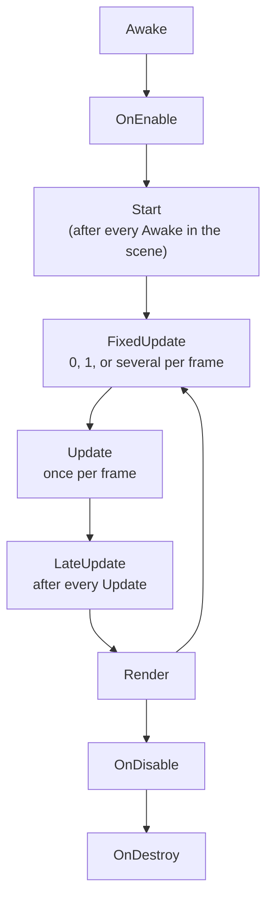

# MonoBehaviour lifecycle

Which callback runs when, and what each one may assume about the rest of the scene. Most "works in one scene, null in another" bugs are a script reading another script before that script has set itself up. The [health](../systems/health.md) page had one: `Health` read a stat sheet in `OnEnable` that the sheet only built in its own `Awake`.

The timing of `FixedUpdate` against the rendered frame is on the [fixed timestep](../../physics/fixed-timestep.md) page. This page is about order.

## The order

For an object that is active when the scene loads:



`Awake` and `OnEnable` are called per script, so one script can be enabled before another script in the same scene has run `Awake`. Unity promises less than the diagram suggests:

- A script's own `Awake` runs before its own `OnEnable`, and before its own `Start`.
- Every `Awake` in the scene runs before any `Start`.
- The order of `Awake` across objects is not deterministic. Nor is the order of any callback between scripts with the same execution order.

## What each callback may assume

| Callback | Runs | Use it to | Do not |
| --- | --- | --- | --- |
| `Awake` | Once, when the object is first active. Runs even if the component is disabled. | Cache your own components. Build your own state. | Read state that another object builds in its `Awake`. |
| `OnEnable` | Every time the component becomes enabled and active. | Subscribe to events. Register with a manager. | Assume another object's `Awake` has run. |
| `Start` | Once, before the first `Update`, and only if the component is enabled. | Read other objects. They have all run `Awake`. | Rely on it for a component that starts disabled. It waits until first enabled. |
| `FixedUpdate` | Zero or more times per frame, on the physics step. | Forces and `linearVelocity`. | Read one-frame input such as `wasPressedThisFrame`. |
| `Update` | Once per frame. | Input and most gameplay. | Follow something another `Update` moves. |
| `LateUpdate` | Once per frame, after every `Update`. | Cameras and anything that follows a moved object. | Move objects other scripts' `LateUpdate` follow. |
| `OnDisable` | On disable, deactivation, `Destroy`, scene unload, and domain reload. | Unsubscribe. Undo what `OnEnable` did. | Assume the object is about to be destroyed. |
| `OnDestroy` | When destroyed, on scene unload, on quit. Only if the object was ever active. | Release what `Awake` allocated. | Save game state on mobile. The OS can kill the app without it. |

## Spawning at runtime

`Instantiate` of an active prefab runs `Awake` and `OnEnable` inside the call, before it returns. `Start` runs later, before the end of the frame. So a field you set on the line after `Instantiate` is too late for `Awake` and `OnEnable`, and in time for `Start`.

When a spawned object needs data before it enables, instantiate the prefab with its root inactive, set the data, then activate it. The [object pooling](pooling.md) page does exactly that, and gives the reason: a trail or an agent that enables at the old pose draws a line or snaps.

## Disabled or inactive

| | Component disabled (`enabled = false`) | GameObject inactive (`SetActive(false)`) |
| --- | --- | --- |
| `Awake` | Still runs, if the object is active. | Waits until the object is first activated. |
| `OnEnable`, `Start`, updates | Do not run. | Do not run. |
| Coroutines started by the script | **Keep running.** | Stop. |
| Physics callbacks on its colliders | Still sent. A disabled script still gets `OnTriggerEnter` and `OnCollisionEnter`. | Not sent. |

The coroutine row catches people. Disabling a component to pause it does not pause a coroutine it started. Deactivate the object, or stop the coroutine in `OnDisable`.

## Destroy

`Destroy` is deferred. The object goes after the current update loop, before rendering. Until then it still exists, its other callbacks this frame still run, and `== null` is still false. `Destroy(obj, t)` waits `t` seconds of scaled time, so a paused game never finishes the timer.

`DestroyImmediate` is for editor code. In play it destroys mid-loop, and anything holding a reference finds a dead object before the frame has finished.

## Execution order

Two scripts that must run in a fixed order get different numbers, either with `[DefaultExecutionOrder(n)]` on the class or in **Project Settings → Script Execution Order**. Lower numbers run first, and every instance of a lower-numbered script runs before any instance of a higher one.

- Scripts with the same number, including the default of `0`, have no defined order. One that looks stable in the editor may change in a build.
- The order does not apply to `OnDisable` and `OnDestroy`, or to events such as `OnTriggerEnter`.
- With scenes loaded additively, the order is applied to one scene at a time.
- If both the attribute and the Project Settings give a number, the Project Settings value wins.

Use the attribute for the few scripts that really are ordered, such as an input reader before the movement that consumes it. The patterns below remove most of the need for it.

## Patterns

### A provider that builds on first use

When other scripts read something you build, build it on the first read as well as in `Awake`. Callers stop depending on order. This is the fix the stat sheet on the health page uses.

```csharp
using System.Collections.Generic;
using UnityEngine;

public class Registry : MonoBehaviour
{
    readonly Dictionary<string, int> _values = new Dictionary<string, int>();
    bool _built;

    void Awake()
    {
        Build();
    }

    public bool TryGet(string key, out int value)
    {
        Build(); // A caller's OnEnable may run before this Awake.
        return _values.TryGetValue(key, out value);
    }

    void Build()
    {
        if (_built)
            return;
        _built = true;
        // Fill _values from serialized data here.
    }
}
```

### Subscribe in OnEnable, unsubscribe in OnDisable

The pair is symmetrical, so disabling, reactivating, and destroying all leave exactly one subscription or none. Subscribing in `Awake` or `Start` subscribes once and never stops, so a disabled listener keeps reacting, and a destroyed one throws when the event fires.

```csharp
using UnityEngine;

public class DeathSound : MonoBehaviour
{
    [SerializeField] Health health;
    [SerializeField] AudioSource source;

    void OnEnable()
    {
        if (health != null)
            health.Died += OnDied;
    }

    void OnDisable()
    {
        if (health != null)
            health.Died -= OnDied;
    }

    void OnDied()
    {
        if (source != null)
            source.Play();
    }
}
```

### Read other objects in Start

Cross-object setup, such as finding the player or reading a manager's settings, belongs in `Start`. Every `Awake` has run by then. If the result is needed in `OnEnable`, use the provider pattern on the other side instead of moving the read earlier.

!!! warning "Common pitfalls"

    A subclass that declares `Awake`, `Start`, or another callback with the same name hides the base class's private one, and Unity calls only the subclass's. Make the base method `protected virtual`, and call `base.Awake()` from the override.

    `Start` on a component that is disabled in the scene does not run until the first time it is enabled, which may be minutes later. Initialisation that must happen at load goes in `Awake`.

    A component disabled in the inspector still runs `Awake`. A GameObject inactive in the scene does not, until it is first activated. Two objects that "should both be ready" may not be if one is under an inactive parent.

    `OnDestroy` only runs on objects that were active at some point. A prefab instance that was spawned inactive and never activated gets no `OnDestroy`.

    Two scripts with the same execution order can swap order between the editor and a build. If a bug only appears in a build, look for a read in `Awake` or `OnEnable` of something another script builds.
