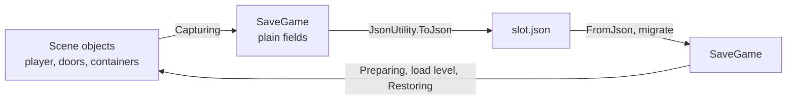

# Saving

A save is a plain data snapshot, written as JSON with `JsonUtility`. Game objects copy their state into it and read it back. They never serialize themselves, and the file never holds a reference to a Unity object.

| Page | Covers |
| --- | --- |
| [Save system](save-system.md) | The `SaveGame` class, slots, atomic file writes, writing off the main thread, autosave, and the player's record. |
| [World state](world-state.md) | Stable ids for scene objects, then doors, containers, destroyed and spawned objects, and scenes that load and unload while playing. |
| [Versioning](versioning.md) | Changing `SaveGame` after release: free changes, renames, and migration steps that upgrade old files. |

## The flow

- **Capture on the main thread.** Unity objects can only be read there. Turning the snapshot into a string is quick. Writing the file is the slow part, and only that moves to a background thread.
- **Restore after the level loads.** Load the scene the save names, then hand the data to the objects in it.
- **Save ids, not references.** An item is its definition id. A door is its `SaveId`. A `ScriptableObject` or a `GameObject` written by `JsonUtility` becomes an instance id, which means nothing in the next session.

## What does not go in a save

- **Settings.** Volume, key bindings, and graphics belong to the player, not to a save slot. Keep them in `PlayerPrefs` or a separate settings file, so loading an old save does not reset them.
- **Anything rebuilt on load.** Caches, pooled objects, navigation paths, and UI state. Save the inputs that rebuild them.
- **Static content.** Item stats, loot tables, and prefabs live in the build. The save names them by id.

A save is a file on the player's machine. Anyone can edit it. Check values you read, such as counts and health, and do not treat a save as proof of anything in a multiplayer game.
