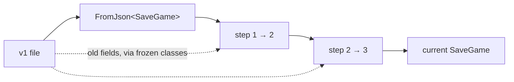

# Versioning saves

Players keep saves across updates. Every change to [`SaveGame`](save-system.md#data), to a component's [saved state](world-state.md#ids-and-records), or to an id the save refers to is a change to a file format that is already on their disks. This page sorts those changes into free ones and ones that need a migration step, and shows how to test them.

## Free changes

`JsonUtility.FromJson` builds the object with its field initializers, then fills in the fields the JSON has. So:

| Change | Effect on an old file |
| --- | --- |
| Add a field | It keeps its initializer. Give it a sensible one: `public float stamina = 1f;`, not a bare `0`. |
| Add a list or class field | Initialize it, `= new List<T>()`, so code never meets null. |
| Remove a field | The old value in the file is ignored. |
| Reorder fields | No effect. Fields are matched by name. |

Free changes need no version bump.

## Changes that need a step

- **Renaming a field.** The old file has the old name, which is now ignored, and the new field keeps its initializer. Unity's serializer reads an old name given in `[FormerlySerializedAs("oldName")]`, and `JsonUtility` uses that serializer. Test it with a real old file before relying on it, or write a step.
- **Changing a field's type**, such as `int` to `float` is fine, but `string` to a class, or one value to a list, is not.
- **Changing a field's meaning**, such as health saved as points becoming a fraction.
- **Moving a field** into or out of a nested class.
- **Renaming content**: an item id, a prefab key, a scene path, a `SaveKey`. The JSON reads fine and then refers to nothing. See [content ids](#content-ids).

Each of these bumps `SaveManager.CurrentVersion` by one and adds a step.

## Migrations

A step does not rewrite the JSON text, because `JsonUtility` has no way to edit a document it does not have a class for. Instead, the file is read once into the current `SaveGame`, which picks up every field whose name still matches. Then each step from the file's version up to the current one patches that object, reading any old fields it needs from the original text with a small frozen class.



```csharp
using System;
using System.Collections.Generic;
using UnityEngine;

/// <summary>
/// Reads a save of any older version into the current SaveGame.
/// </summary>
public static class SaveMigrations
{
    [Serializable]
    class Envelope
    {
        public int version;
    }

    // Key n patches a save written at version n up to version n + 1. Never remove a step.
    static readonly Dictionary<int, Action<string, SaveGame>> s_steps = new Dictionary<int, Action<string, SaveGame>>
    {
        { 1, V1ToV2 },
        { 2, V2ToV3 },
    };

    public static bool TryLoad(string json, int current, out SaveGame save, out string error)
    {
        save = null;
        try
        {
            int version = JsonUtility.FromJson<Envelope>(json).version;
            if (version <= 0)
                version = 1; // written before the version field existed
            if (version > current)
            {
                error = "This save was made by a newer version of the game.";
                return false;
            }

            save = JsonUtility.FromJson<SaveGame>(json);
            for (int v = version; v < current; v++)
            {
                if (!s_steps.TryGetValue(v, out Action<string, SaveGame> step))
                {
                    error = "No upgrade from save version " + v + ".";
                    save = null;
                    return false;
                }
                step(json, save);
            }

            save.version = current;
            error = null;
            return true;
        }
        catch (Exception e)
        {
            error = "The save is damaged: " + e.Message;
            save = null;
            return false;
        }
    }

    // Example. v1 stored the level by scene name; v2 stores its path.
    static void V1ToV2(string json, SaveGame save)
    {
        if (!string.IsNullOrEmpty(save.activeScene) && !save.activeScene.EndsWith(".unity"))
            save.activeScene = "Assets/Scenes/Levels/" + save.activeScene + ".unity";
    }

    // Example. v3 renamed playTimeSeconds to playTime. The old name is read with a frozen class.
    [Serializable]
    class V2Fields
    {
        public float playTimeSeconds;
    }

    static void V2ToV3(string json, SaveGame save)
    {
        save.playTime = JsonUtility.FromJson<V2Fields>(json).playTimeSeconds;
    }
}
```

The two steps are examples of the patterns, written as if `SaveGame` had gone through those changes. Start with an empty dictionary and `CurrentVersion = 1`. With this class in the project, replace the stub on the save system page.

- **Frozen classes never change.** `V2Fields` describes what a version 2 file looked like. It is private to the migration and is not the live type.
- **Steps run in order**, so step 2 sees what step 1 did.
- **A step can stop compiling** when a later version removes the field it writes. Point it at the field that replaced it. That is the cost of patching the live object, and the compiler finds every case.
- **A version newer than the game** is refused, not guessed at. A player who rolls back an update gets a clear message and an untouched file.
- **Component state** is a JSON string per component, so its format is the component's own business. A component that changes its state struct reads the old shape in `RestoreJson`: keep a version field in its struct, or try the old frozen struct when a new field is missing.

## Content ids

Renamed content breaks saves that parse perfectly. Item ids, prefab keys, `SaveId`s, and scene paths are all strings the save trusts.

- **Choose ids once and leave them.** An item's [definition id](../inventory/index.md#definition) is separate from its display name and its asset name for this reason.
- **Keep an alias table** for ids that had to change. Look it up in the catalogue, so every place that reads an id, including ids inside component JSON, picks it up:

```csharp
// In ItemCatalogue (and the same in PrefabCatalogue): a serialized list of old to new ids.
[Serializable] public struct Alias { public string from; public string to; }
[SerializeField] Alias[] aliases = Array.Empty<Alias>();

// In TryGet, when the id is not found, check the aliases once:
foreach (Alias alias in aliases)
{
    if (alias.from == id)
        return _byId.TryGetValue(alias.to, out definition);
}
```

- **Removed content** comes back as an unknown id. The catalogues return nothing and the caller skips it. Decide whether that is right, or whether a step should refund it as something else.
- **Moved scenes** are fixed in a step that maps old paths to new ones, as `V1ToV2` does.

## Testing old saves

Before each release that bumps the version, copy a real save from the old build into the project. An EditMode test then loads every one of them on every change:

```csharp
using System.IO;
using NUnit.Framework;

public class SaveMigrationTests
{
    // Assets/Tests/Saves/v1.json, v2.json, ... one per shipped version.
    [TestCase("v1")]
    [TestCase("v2")]
    public void OldSaveLoads(string name)
    {
        string json = File.ReadAllText("Assets/Tests/Saves/" + name + ".json");

        bool loaded = SaveMigrations.TryLoad(json, SaveManager.CurrentVersion, out SaveGame save, out string error);

        Assert.IsTrue(loaded, error);
        Assert.AreEqual(SaveManager.CurrentVersion, save.version);
        Assert.IsFalse(string.IsNullOrEmpty(save.activeScene));
    }
}
```

The test needs an assembly definition that references the game's code and the test framework. Add asserts for the values each step fixes, such as the play time surviving the rename.

!!! warning "Common pitfalls"

    Renaming a field with no step loses the value in every existing save, silently. Search the diff for renamed `SaveGame` fields before release.

    Running steps by re-serializing with the current class between them drops fields that a later step still needs. Read old fields from the original text.

    Deleting an old step because "nobody has that version" breaks the player who skipped five updates. Keep every step.

    A save from a newer build overwritten by an older one loses whatever the newer build added. Refuse newer versions.

    Changing an item id or a prefab key without an alias deletes it from every save.
