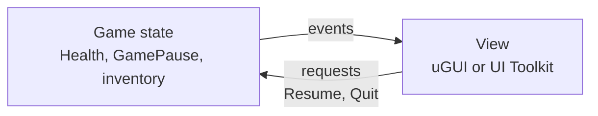

# uGUI and UI Toolkit

Unity 6 ships two runtime UI systems. **uGUI** (Unity UI) builds UI from GameObjects with `RectTransform`s under a `Canvas`. **UI Toolkit** builds it from a tree of `VisualElement`s, laid out by UXML documents and styled by USS style sheets, closer to the web. This page is about choosing between them, keeping the game's state out of either, and the traps that cost frame time.

## Which to use

Unity's own comparison, for 6.3, recommends **uGUI for runtime UI**, with UI Toolkit as the alternative, and **UI Toolkit for editor tools**.

| Choose | When |
| --- | --- |
| **uGUI** | UI driven by the Animator or Timeline, UI edited in the scene next to the objects it belongs to, events wired in the inspector, a team of artists used to GameObjects, or existing uGUI content. |
| **UI Toolkit** | Lots of screens that must work at many resolutions, designers working in UI Builder, global styles, data binding, transitions in USS, right-to-left text, SVG, or custom UI shaders. Unity also lists world-space and VR UI as a common UI Toolkit use. |
| **UI Toolkit, always** | Custom inspectors, property drawers, and editor windows. |

Both handle screen and world space, the Input System, rich text, font fallbacks, sprite atlases, and masking. What uGUI lacks is data binding, USS transitions, a dynamic atlas, anti-aliasing, and flexible layout. What UI Toolkit lacks is in-scene authoring, serialised events, and Animation Clip and Timeline integration.

Both can run in one project. A common split is uGUI for world-space and animated HUD pieces, and UI Toolkit for menus.

## Keep the game out of the UI

Whichever system draws it, UI code should only do two things: show state it is told about, and report what the player asked for. It should not hold the state.



- The view subscribes in `OnEnable`, unsubscribes in `OnDisable`, and refreshes once on enable so it starts correct. That is the [lifecycle](../architecture/lifecycle.md#subscribe-in-onenable-unsubscribe-in-ondisable) pair.
- The view updates when an event fires, not every frame. A HUD that formats text in `Update` allocates a string per frame for nothing.
- A button does not change game state directly. It calls a method on the state's owner, which decides, and then raises the event that updates every view.

Then the same state can have two views, such as a HUD bar and a damage vignette, and swapping uGUI for UI Toolkit touches only the view.

## A health bar in both

The uGUI version is the `HealthBar` on the [health](../systems/health.md#health-bar) page: an `Image` set to **Filled**, with `fillAmount` set from `HealthChanged`. Adding a number to it is one `TMP_Text`:

```csharp
// In the uGUI HealthBar: a [SerializeField] TMP_Text label, using TMPro.
// SetText with arguments formats without allocating a string.
label.SetText("{0:0} / {1:0}", current, max);
```

The UI Toolkit version. The UXML holds a `ProgressBar` named `health`:

```xml
<ui:UXML xmlns:ui="UnityEngine.UIElements">
    <ui:ProgressBar name="health" title="HP" high-value="100" />
</ui:UXML>
```

```csharp
using UnityEngine;
using UnityEngine.UIElements;

/// <summary>
/// Shows a Health in a UI Toolkit ProgressBar named "health".
/// </summary>
[RequireComponent(typeof(UIDocument))]
public class HealthBarElement : MonoBehaviour
{
    [SerializeField] Health health;

    ProgressBar _bar;

    void OnEnable()
    {
        // The document builds its tree in its own OnEnable. Query it again every time this enables.
        _bar = GetComponent<UIDocument>().rootVisualElement.Q<ProgressBar>("health");
        if (health == null || _bar == null)
            return;

        health.HealthChanged += Refresh;
        Refresh(health.Current, health.Max);
    }

    void OnDisable()
    {
        if (health != null)
            health.HealthChanged -= Refresh;
    }

    void Refresh(float current, float max)
    {
        _bar.lowValue = 0f;
        _bar.highValue = Mathf.Max(max, 0.0001f);
        _bar.value = current;
        _bar.title = Mathf.CeilToInt(current) + " / " + Mathf.CeilToInt(max);
    }
}
```

The string concatenation allocates, but only when health changes.

## A pause menu in both

The state is one small class. Anything can ask to pause, and every view listens:

```csharp
using System;
using UnityEngine;

/// <summary>
/// Owns the paused state. Views listen to Changed and call SetPaused.
/// </summary>
public static class GamePause
{
    public static bool IsPaused { get; private set; }
    public static event Action<bool> Changed;

    [RuntimeInitializeOnLoadMethod(RuntimeInitializeLoadType.SubsystemRegistration)]
    static void ResetStatics()
    {
        IsPaused = false;
        Changed = null;
    }

    public static void SetPaused(bool paused)
    {
        if (IsPaused == paused)
            return;

        IsPaused = paused;
        Time.timeScale = paused ? 0f : 1f;
        Changed?.Invoke(paused);
    }
}
```

The two views show the same menu, with Resume and Quit buttons:

=== "uGUI"

    ```csharp
    using UnityEngine;
    using UnityEngine.EventSystems;
    using UnityEngine.UI;

    /// <summary>
    /// A pause panel on a Canvas. Hidden by disabling its Canvas, not its GameObject.
    /// </summary>
    [RequireComponent(typeof(Canvas))]
    public class PauseMenu : MonoBehaviour
    {
        [SerializeField] Button resume;
        [SerializeField] Button quit;

        Canvas _canvas;

        void Awake()
        {
            _canvas = GetComponent<Canvas>();
        }

        void OnEnable()
        {
            resume.onClick.AddListener(OnResume);
            quit.onClick.AddListener(OnQuit);
            GamePause.Changed += Show;
            Show(GamePause.IsPaused);
        }

        void OnDisable()
        {
            resume.onClick.RemoveListener(OnResume);
            quit.onClick.RemoveListener(OnQuit);
            GamePause.Changed -= Show;
        }

        void Show(bool visible)
        {
            _canvas.enabled = visible;

            // Give a gamepad something to navigate from.
            if (visible && EventSystem.current != null)
                EventSystem.current.SetSelectedGameObject(resume.gameObject);
        }

        void OnResume() => GamePause.SetPaused(false);
        void OnQuit() => Application.Quit();
    }
    ```

=== "UI Toolkit"

    ```csharp
    using UnityEngine;
    using UnityEngine.UIElements;

    /// <summary>
    /// A pause panel in a UIDocument, with Buttons named "resume" and "quit" inside an element named "pause".
    /// </summary>
    [RequireComponent(typeof(UIDocument))]
    public class PauseMenuDocument : MonoBehaviour
    {
        VisualElement _panel;
        Button _resume;
        Button _quit;

        void OnEnable()
        {
            VisualElement root = GetComponent<UIDocument>().rootVisualElement;
            _panel = root.Q<VisualElement>("pause");
            _resume = root.Q<Button>("resume");
            _quit = root.Q<Button>("quit");

            _resume.clicked += OnResume;
            _quit.clicked += OnQuit;
            GamePause.Changed += Show;
            Show(GamePause.IsPaused);
        }

        void OnDisable()
        {
            if (_resume != null)
                _resume.clicked -= OnResume;
            if (_quit != null)
                _quit.clicked -= OnQuit;
            GamePause.Changed -= Show;
        }

        void Show(bool visible)
        {
            // None removes it from layout and from picking. Hidden would keep its space.
            _panel.style.display = visible ? DisplayStyle.Flex : DisplayStyle.None;
            if (visible)
                _resume.Focus();
        }

        void OnResume() => GamePause.SetPaused(false);
        void OnQuit() => Application.Quit();
    }
    ```

Something else, such as the input code for Escape, calls `GamePause.SetPaused(!GamePause.IsPaused)`. Code that should keep running while paused, such as menu animations and the [loading screen fade](../architecture/scenes.md#scene-loader), uses unscaled time.

## Performance and layout

### uGUI

- **A canvas rebuilds as a whole.** When any graphic under a `Canvas` changes, that canvas rebuilds its batches. Put things that change every frame, such as a timer or a cooldown sweep, on their own nested `Canvas`, so the static frame around them is not rebuilt with them.
- **Hide with the Canvas, not the GameObject.** Setting `Canvas.enabled = false` stops drawing and keeps the built geometry. `SetActive(false)` throws it away, and reactivating rebuilds it and runs every `OnEnable` below. For fades, a `CanvasGroup` alpha.
- **Turn off Raycast Target** on every image and text that is not clickable. Each one with it on is tested on every pointer event, and a decorative image can block a button behind it.
- **Layout groups are for layout, not animation.** `LayoutGroup` and `ContentSizeFitter` recalculate whenever a child changes. On a list that updates every frame, they dominate the cost. Position frequently changing elements yourself.
- **Scale with the screen.** On the Canvas Scaler, use **Scale With Screen Size** with a reference resolution, and **Match** 0.5 or towards the dominant axis. Anchor elements to the corners and edges they belong to.
- **Respect the safe area.** On phones with notches, fit the HUD root to `Screen.safeArea`.

### UI Toolkit

- **Query in `OnEnable`.** `UIDocument` builds its tree when it enables. References from `Awake` are stale after the document is disabled and enabled.
- **Move with `translate`.** Changing `left`, `top`, `width`, `height`, or flex properties dirties layout, which can cascade through the tree. `style.translate` moves an element without layout. For an element that moves often, set `usageHints = UsageHints.DynamicTransform` so its transform updates on the GPU.
- **`display: none` versus `visibility: hidden`.** None removes the element from layout and from picking. Hidden keeps its space and stops drawing it.
- **Scale with the screen** in the Panel Settings asset: **Scale Mode** set to **Scale With Screen Size**, with a reference resolution. Every UIDocument that uses the same Panel Settings shares one panel, and **Sort Order** on the asset orders panels.
- **Style in USS, not in code.** Setting `style.*` inline from C# overrides the style sheet for that element and is easy to lose track of. Toggle USS classes with `AddToClassList` and `RemoveFromClassList` instead, and let the sheet, and its transitions, do the work.

!!! warning "Common pitfalls"

    A uGUI scene without an **EventSystem** does not respond to clicks at all. Create one with the UI, and keep a single one, in a scene that is always loaded, such as the [Core scene](../architecture/scenes.md).

    A view that subscribes in `Awake` or `Start` and never unsubscribes keeps a destroyed view alive in the event's list, and throws the next time it fires.

    A UIDocument queried in `Awake` returns elements that are replaced when the document re-enables. Query in `OnEnable`.

    `Time.timeScale = 0` stops `Update`'s scaled time, `WaitForSeconds`, and Animator components on **Normal** update mode. A pause menu that animates needs **Unscaled Time**.

    Text formatted every frame in `Update` allocates every frame. Update text from events, and with TextMeshPro use `SetText` with arguments.
